# P31 Labs — Per-Page Content Overhaul Runbook

**Status:** chrome + ambient shipped (v2.1, all 12 routes → dome). This runbook is the content layer.
**Scope:** every public page on p31ca.org gets a defined content structure, the diagrams it needs, the data source, and a "done" definition.
**Prerequisite:** read `BUILD_PACKAGE.md` §3 (information architecture) and §8.5 (per-page plans) first — this expands those into buildable tasks.
**Verified against the repo 2026-09-23** — see §0.1 for the current-state inventory.

---

## 0 · Universal rules

Every page in this runbook obeys:

1. **The dome + starfield is behind it.** No page opts out. If a page needs a "solid" backdrop for readability, use a translucent glass panel over the dome — never hide the ambient layer.
2. **One `<CanonTopbar>` — from the shell.** Pages must NOT import `CanonTopbar`. If you find one, remove it (this was a real regression fixed in v2.1 — the fix pattern is in §10).
3. **Content answers three questions.** What is this? Why does it matter? What do I do next?
4. **Mermaid diagrams follow the house style** (§7) — no hardcoded fills, every node classed, labels < 40 chars.
5. **No invented metrics.** Every number on a page resolves to a live endpoint, a registry, a DOI, or a file on disk. State the source inline.
6. **Reduced-motion and reduced-transparency floors hold.** The dome may drift; the copy never animates past 200ms.

### 0.1 · Verified current state (what the runbook builds on)

| Page | Route | Exists | Content state |
|---|---|---|---|
| Home | `/` | ✅ | Reference — scene spec in `BUILD_PACKAGE.md` §4.4 |
| About | `/about` | ✅ | **Dead** — 3 glass cards (Mission / Founder / 501c3), no narrative, no diagrams |
| Enterprise | `/enterprise` | ✅ | Marketing copy; zero Mermaid diagrams |
| Hire | `/hire` | ✅ | Roles referenced; no hiring-journey flow |
| Research | `/research` | ✅ | **Good** — `src/data/p31-research.ts` (verified DOIs, `Paper[]` schema) → `ResearchCard` grid |
| Get involved | `/get-involved` | ✅ | 3 CTAs, no contributor flow |
| Donate | `/donate` | ✅ | Donation links, no treasury flow |
| Treasury | `/treasury` | ✅ | Live ledger, no quarterly-report gantt |
| Arcade | `/arcade` | ✅ | Game list, no per-game flow |
| Journey | `/journey` | ✅ | Reference — hub + wizard |
| Sign in / Sign up | `/signin` `/signup` | ✅ | Forms, no identity flow |
| Apps/* | `/apps/*` | ✅ | Reference — 8 flagship pages via `FlagshipPage.astro` |
| **Team** | `/team` | ❌ | **Missing** |
| **Ways to give** | `/ways-to-give` | ❌ | **Missing** |
| **Financials** | `/financials` | ❌ | **Missing** |
| **Annual report** | `/annual-report` | ❌ | **Missing** |
| **FAQ** | `/faq` | ❌ | **Missing** |
| **Press** | `/press` | ❌ | **Missing** |
| **Privacy** | `/privacy` | ❌ | **Missing** |
| **Accessibility** | `/accessibility` | ❌ | **Missing** |
| **Terms** | `/terms` | ❌ | **Missing** |

**No content-collections config exists** (`src/content.config.ts` missing). Research data lives in a typed TS source, not a collection — the runbook keeps that source as the collection's backing data (§4.2).

**All 12 existing routes already render the dome + shell chrome.** The chrome work is done; this runbook is content.

---

## 1 · Page inventory and the build order

Build highest-leverage first. The order below matches visitor intent: *who are you → why should a company care → do you have the receipts → can I trust you → how do I help → the compliance floor.*

| # | Page | Route | Theme | Build order |
|---|---|---|---|---|
| 1 | About | `/about` | sunlight | **1** |
| 2 | Team | `/team` | sunlight | **1** |
| 3 | Enterprise | `/enterprise` | sunlight | **2** |
| 4 | Research | `/research` | sunlight | **3** |
| 5 | FAQ | `/faq` | sunlight | **4** |
| 6 | Ways to give | `/ways-to-give` | sunlight | **4** |
| 7 | Annual report | `/annual-report` | sunlight | **4** |
| 8 | Financials | `/financials` | sunlight | **4** |
| 9 | Hire | `/hire` | sunlight | **5** |
| 10 | Get involved | `/get-involved` | sunlight | **5** |
| 11 | Press | `/press` | sunlight | **6** |
| 12 | Privacy | `/privacy` | sunlight | **6** |
| 13 | Accessibility | `/accessibility` | sunlight | **6** |
| 14 | Terms | `/terms` | sunlight | **6** |
| 15 | Donate | `/donate` | sunlight | **5** (refine — flow + 501c3 proof) |
| 16 | Treasury | `/treasury` | sunlight | **5** (refine — add gantt) |
| 17 | Arcade | `/arcade` | sunset | **7** (refine — per-game flow) |
| 18 | Sign in / Sign up | `/signin` `/signup` | sunlight | **7** (refine — ID flow) |
| — | Home | `/` | ocean | Reference — no change |
| — | Journey | `/journey` | ocean | Reference — no change |
| — | Apps/* | `/apps/*` | cipher | Reference — no change |

---

## 2 · Per-page content specs

Each spec follows: **why it exists → structure → diagrams → data source → done when.**

---

### 2.1 · `/about` — the origin story

**Why it exists.** The visitor is deciding whether to trust the org. Lead with the story, not the chronology.

**Structure.**

1. **Hero** — one sentence: "Sovereign infrastructure for neurodivergent families, built by a father who needed it." *(present today)*
2. **The world before** — 2–3 short paragraphs. What the founder was navigating; why existing tools failed. Narrative voice.
3. **The turn** — what changed. The moment the stack became necessary.
4. **The build** — the 12 Workers / 10 D1 / 16 Durable Objects / 36 MCP tools, each with a source. Renders **§7.2 (architecture)**.
5. **The K4 / tetrahedron** — a small inline diagram of the minimum isostatic structure (4 vertices, 6 edges, rigidity = 6). Renders as inline SVG (§7.3).
6. **The org timeline** — Renders **§7.4 (org timeline)** with: founded → first flagship live → 501(c)(3) determination → 23 papers → v2.0 package.
7. **The 501(c)(3) proof** — a facts card: EIN, determination date, deductibility language, a link to the IRS letter PDF. Reads from the single source (§8).
8. **CTA** — "Meet the team" → `/team`, "Read the research" → `/research`.

**Diagrams.** §7.2 architecture, §7.3 K4 SVG, §7.4 timeline.

**Data source.** `src/data/p31-research.ts` (the 23-paper count), the nonprofit facts card (§8), the flagships data (which flagship came first).

**Done when.** A stranger reads it and can say who built P31, why, and when it became a nonprofit — and every fact resolves to a file on disk.

---

### 2.2 · `/team` — the people

**Why it exists.** Trust scales with faces and bios.

**Structure.**

1. **Board** — name, role, one-paragraph bio, LinkedIn (optional), photo or initial avatar.
2. **Staff** — same shape.
3. **Advisory council** — same shape, marked advisory.
4. **Contributors** — a link to the GitHub contributor graph, plus a short "how to contribute" note linking to `/get-involved`.

**Diagrams.** None required.

**Data source.** New `src/content/team/*.md` (see §4.1 for the zod schema). If the roster is small, a single `src/data/team.ts` (the pattern already used for research) is acceptable — pick one, don't do both.

**Done when.** Every person listed has a bio (or an honest "bio pending" placeholder), and the contributor link resolves.

---

### 2.3 · `/enterprise` — the procurement page

**Why it exists.** A procurement, security, or platform team is deciding whether P31 is worth a pilot.

**Structure.**

1. **Hero** — one line: "Verifiable agent governance."
2. **The 90-second verify** — the three curl commands from `ENTERPRISE_PACKAGE.md` §1, as copyable code blocks with expected output.
3. **The diagrams** — the Mermaid diagrams from `ENTERPRISE_PACKAGE.md` rendered inline:
   - §7.2 architecture (the deployed stack)
   - §7.5 Loom pipeline (the hash-chain + WIMSE pipeline)
   - §7.6 identity chain (did:key → SBT → capability token)
   - §7.7 standards timeline
   - §7.8 security posture (the three honest gaps, visually distinct)
4. **The honest gaps** — the three caveats from `ENTERPRISE_PACKAGE.md` §6.2 rendered as amber chips, not buried.
5. **The packages table** — `@p31ca/design-core` and `@p31ca/cli` published; the rest built but not on npm.
6. **CTA** — "Start a pilot" → mailto; "Read the full package" → the markdown file on GitHub.

**Diagrams.** The seven from `ENTERPRISE_PACKAGE.md`.

**Data source.** `ENTERPRISE_PACKAGE.md` itself (single source of truth — the page is a rendering of the markdown, not a parallel copy).

**Done when.** The page renders every diagram from the package and states the gaps without softening.

---

### 2.4 · `/hire` — the hiring page

**Structure.**

1. **Hero** — "Build the stack that proves what the AI did."
2. **Open roles** — card list: title, location, one-line scope, link. Empty state: "No open roles right now — but we always want to hear from people who care about this."
3. **The hiring journey** — **§7.9 (hiring journey)** as a `flowchart LR`: read → apply → screen (30m) → technical (2h) → decision → offer.
4. **Values** — 3–4 short principles.
5. **CTA** — apply per role; general applications → a mailto.

**Diagrams.** §7.9.

**Done when.** A candidate knows the process end-to-end before applying.

---

### 2.5 · `/research` — the credibility page

**Why it exists.** The visitor wants to check the receipts.

**Structure.**

1. **Hero** — "23 open-access papers. All with DOIs." *(present)*
2. **The DOI timeline** — **§7.10 (research timeline)** as a Mermaid `timeline` of the papers by publication date.
3. **Per-paper cards** — title, DOI (resolvable link), abstract (collapsible), download link. **Already implemented** via `ResearchCard.astro`. Keep as-is.
4. **How to cite P31** — a BibTeX block + a plain-text citation line.
5. **CTA** — "View all on Zenodo" → the community URL.

**Diagrams.** §7.10.

**Data source.** `src/data/p31-research.ts` — **already verified** (every DOI returns HTTP 200 as of 2026-09-23). Do not add placeholder DOIs; the file's header comment makes this explicit.

**Done when.** Every DOI resolves (rerun the Zenodo check) and the BibTeX block is copy-pasteable.

---

### 2.6 · `/get-involved` — the contributor page

**Structure.**

1. **Hero** — "Three ways to help."
2. **The contributor flowchart** — **§7.11 (contributor flow)** as a `flowchart TD`: pick a lane → read the package → open an issue → open a PR → get reviewed. Each lane as a subgraph.
3. **Lanes** — code, research, community. Each with a one-line "what you'd do" and a link.
4. **The code of conduct** — a short excerpt + link to the full document.

**Diagrams.** §7.11.

**Done when.** A first-time contributor knows which lane to pick and what happens next.

---

### 2.7 · `/donate` + `/ways-to-give`

**Why these exist.** `/donate` is the quick path; `/ways-to-give` is the taxonomy — the "jewel" page.

**`/donate` structure.**

1. **Hero** — the mission line + one CTA.
2. **The treasury flow** — **§7.12 (treasury flow)** as a `flowchart LR`: donation → D1 ledger → quarterly report. Every dollar traced.
3. **501(c)(3) proof** — EIN, determination date, deductibility language (reads from §8).
4. **CTA** — the donation form.

**`/ways-to-give` structure.**

A card grid, one card per path: one-time, recurring, major gift, planned, in-kind, stock, crypto, vehicle, employer match, tribute. Each card links to a dedicated flow (or the shared donation form with a `?path=` param).

**Diagrams.** §7.12.

**Done when.** Every donation path has a working destination and the treasury flow is honest about where the money goes.

---

### 2.8 · `/treasury` + `/financials` + `/annual-report`

**Why these exist.** Financial transparency is the trust floor.

**`/treasury` structure.** The live ledger (already present) + **§7.13 (quarterly-report gantt)** of published reports.

**`/financials` structure.**

1. **Form 990 PDF** link.
2. **Program / admin / fundraising breakdown** — **§7.14 (financials pie)**.
3. **Ratings** — Charity Navigator / GuideStar badges if earned. **Never fake** — if not earned, state "not yet rated" honestly.

**`/annual-report` structure.** Board-chair letter, last-year-in-review, financial summary, photo essay, outcomes. Pulls from Form 990.

**Diagrams.** §7.13, §7.14.

**Done when.** The Form 990 link resolves and the pie chart cites the 990 as its source.

---

### 2.9 · `/faq`

**Structure.** 16+ Q&A pairs grouped by topic: "the stack", "the family test", "the nonprofit", "the commercial offering". Each Q&A renders as a `<details>` element for progressive disclosure. Emits **FAQPage JSON-LD** (§6).

**Data source.** New `src/content/faq/*.md` (see §4.3).

**Done when.** The FAQPage JSON-LD validates against schema.org and every answer is honest about what's shipped vs planned.

---

### 2.10 · `/press` + `/privacy` + `/accessibility` + `/terms`

**`/press`.** News mentions (dates + links), media kit (logos, headshots, brand guide as downloadable assets), press contact.

**`/privacy`.** Plain-language disclosure:
- What we store: "the DID on your device only — no server-side identity store"
- Analytics: "none — we don't use Google Analytics, Plausible, or any tracking"
- Cookies: "none except the theme/spoon preference in localStorage"
- How to delete: "clear the site data for this origin"

**`/accessibility`.** WCAG 2.2 AA statement + the accommodations implemented (reduced-motion, reduced-transparency, spoon floors, keyboard navigation for the control instrument) + a contact for reporting issues.

**`/terms`.** Donation T&Cs, photo release, AGPL / MIT license summary.

**Done when.** Each page exists, states its scope, and links to a real contact.

---

### 2.11 · `/arcade` + `/signin` + `/signup`

**`/arcade`.** + a per-game `flowchart` (how you play, what you earn).

**`/signin` `/signup`.** + **§7.15 (federated identity flow)** — how the DID is created, what stays on device, what the server never sees.

**Diagrams.** §7.15.

**Done when.** The flow diagram matches the actual identity code.

---

## 3 · Token additions

Add to `packages/canon/src/css/quantum.css` and mirror in `apps/p31ca/src/styles/molecular-dome.css`:

```css
/* ─── Content pages ─────────────────────────────────────────────── */
--p31-content-max-width: 72ch;
--p31-content-section-gap: clamp(3rem, 8vh, 6rem);
--p31-content-card-radius: 16px;
--p31-content-card-padding: clamp(1.25rem, 3vw, 2rem);
--p31-content-hero-min: calc(60svh - 60px);
```

Role tokens — a content page reads `--p31-content-max-width` for its measure, never `72ch` hardcoded. Same convention as the scene tokens (`--p31-scene-*`).

Rebuild canon after editing: `cd packages/canon && pnpm build`.

---

## 4 · Content collections

Create `src/content.config.ts` (Astro 5 schema location).

### 4.1 · Team

```ts
import { defineCollection, z } from 'astro:content'
import { glob } from 'astro/loaders'

const team = defineCollection({
  loader: glob({ pattern: '**/*.md', base: './src/content/team' }),
  schema: z.object({
    name: z.string(),
    role: z.string(),
    type: z.enum(['board', 'staff', 'advisory']),
    bio: z.string(),
    linkedin: z.string().url().optional(),
    photo: z.string().optional(),
  }),
})
```

A member file (`src/content/team/jane-doe.md`):

```markdown
---
name: Jane Doe
role: Board Chair
type: board
bio: A short, human paragraph. What they bring, why they're here.
linkedin: https://linkedin.com/in/janedoe
---

Optional longer prose here — the `bio` frontmatter is what shows in cards.
```

### 4.2 · Research (wraps the existing source)

The research data already lives in `src/data/p31-research.ts` as a verified `Paper[]`. Do NOT duplicate it into a collection. Instead, keep the TS source as the single source of truth and render it — the existing `ResearchCard.astro` pattern is correct. The collection model is only for content that's hand-authored markdown (team, faq).

### 4.3 · FAQ

```ts
const faq = defineCollection({
  loader: glob({ pattern: '**/*.md', base: './src/content/faq' }),
  schema: z.object({
    q: z.string(),
    a: z.string(),
    category: z.enum(['stack', 'family', 'nonprofit', 'commercial', 'community']),
  }),
})
```

An FAQ file (`src/content/faq/what-is-the-loom.md`):

```markdown
---
q: What is the Loom?
a: A hash-chained audit log for AI agent actions. The public verify endpoint recomputes the chain from genesis.
category: stack
---

Optional longer answer shown when the item is expanded.
```

### 4.4 · Config

```ts
export const collections = { team, faq }
```

Build-time. No runtime cost. The team roster and FAQ change on a human cadence — file-based is the right model.

---

## 5 · Mermaid integration

Zero build impact. The diagram source stays in the HTML for SEO/agent-readability; the render happens client-side with a graceful fallback.

### 5.1 · Astro config

```js
// astro.config.mjs
import rehypeMermaidLite from 'rehype-mermaid-lite'

export default defineConfig({
  markdown: {
    rehypePlugins: [rehypeMermaidLite],
  },
})
```

This transforms ` ```mermaid ` code blocks in markdown into `<pre class="mermaid">` elements for client rendering. For `.astro` page files (which don't go through the markdown pipeline), write the diagrams as `<pre class="mermaid">` directly.

### 5.2 · Client render in the shell

Add to `MarketingShell.astro` (once, in the body):

```html
<script is:inline>
  (function () {
    if (typeof window === 'undefined') return
    document.addEventListener('DOMContentLoaded', async function () {
      var blocks = document.querySelectorAll('pre.mermaid:not([data-rendered])')
      if (!blocks.length) return
      try {
        var mod = await import('https://cdn.jsdelivr.net/npm/mermaid@11/dist/mermaid.esm.min.mjs')
        var mermaid = mod.default
        mermaid.initialize({ startOnLoad: false, theme: 'base', securityLevel: 'strict' })
        for (var i = 0; i < blocks.length; i++) {
          var block = blocks[i]
          try {
            var id = 'm-' + Math.random().toString(36).slice(2)
            var result = await mermaid.render(id, block.textContent || '')
            block.innerHTML = result.svg
            block.setAttribute('data-rendered', '1')
          } catch (_) {
            // graceful fallback — keep the code block visible
          }
        }
      } catch (_) {
        // network failure — leave the source visible, it's still readable
      }
    })
  })()
</script>
```

**Fallback behavior.** If the Mermaid ESM fails to load (offline, CDN block), the diagram source renders as a code block. That's still readable and still crawlable. Never let a diagram failure break a page.

---

## 6 · FAQ JSON-LD

In `/faq`:

```astro
---
import { getCollection } from 'astro:content'
const faqs = await getCollection('faq')
const jsonLd = {
  "@context": "https://schema.org",
  "@type": "FAQPage",
  "mainEntity": faqs.map((f) => ({
    "@type": "Question",
    "name": f.data.q,
    "acceptedAnswer": { "@type": "Answer", "text": f.data.a },
  })),
}
---
<script type="application/ld+json" set:html={JSON.stringify(jsonLd)} />
```

Validate against schema.org's FAQPage shape before shipping.

---

## 7 · The Mermaid house style

### 7.1 · The palette

Two-tone only. Never a color that works in only one theme. The `%%{init}%%` block goes at the top of every diagram.

```
%%{init: {'theme':'base', 'themeVariables': {
  'primaryColor': '#2563eb',
  'primaryTextColor': '#ffffff',
  'primaryBorderColor': '#1e40af',
  'lineColor': '#64748b',
  'background': 'transparent'
}}}%%
```

Every diagram defines the same five classDefs:

```
classDef core fill:#2563eb,stroke:#1e40af,color:#ffffff
classDef infra fill:#64748b,stroke:#334155,color:#ffffff
classDef external fill:#f59e0b,stroke:#b45309,color:#000000
classDef success fill:#10b981,stroke:#047857,color:#ffffff
classDef error fill:#ef4444,stroke:#b91c1c,color:#ffffff
```

**Rules:**
- Define classDefs at the top of every diagram.
- Assign a class to *every* node — unclassed nodes render differently in dark mode.
- Keep labels under 40 characters.
- No emoji in node labels. No gradients.

### 7.2 · Architecture (the stack)

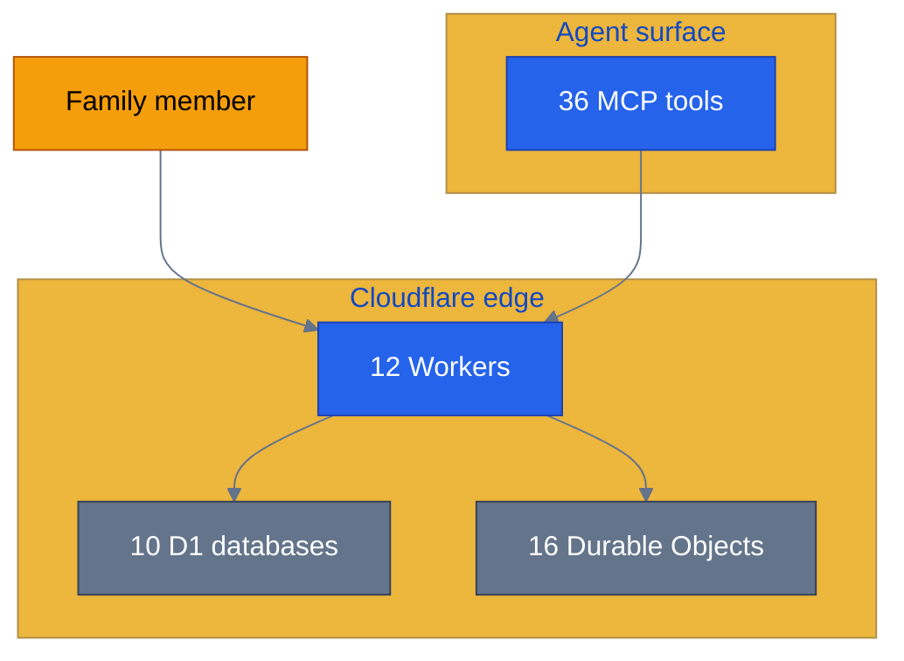

### 7.3 · K4 glyph (inline SVG preferred)

For the tetrahedron glyph, use an inline SVG (Mermaid renders it poorly). 4 vertices, 6 edges, all strokes `var(--p31-accent)`, no fill.

### 7.4 · Org timeline

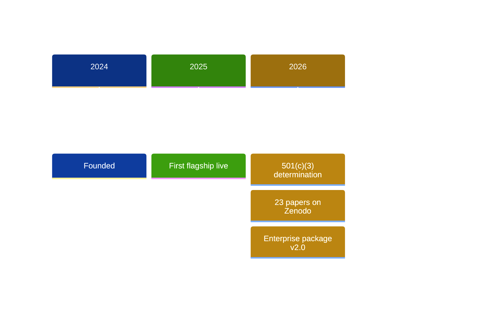

### 7.5 · Loom pipeline

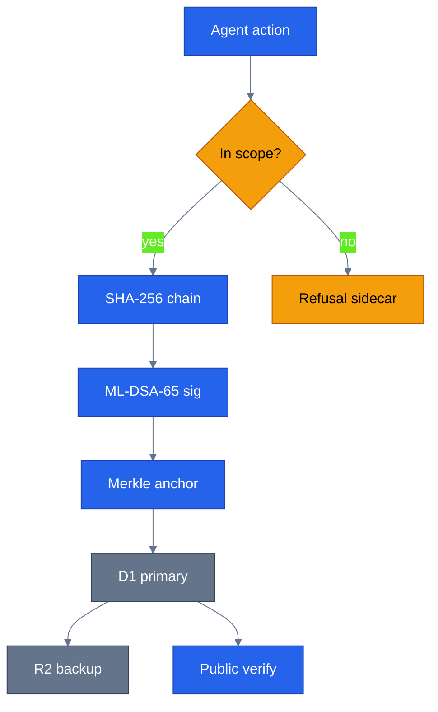

### 7.6 · Identity chain

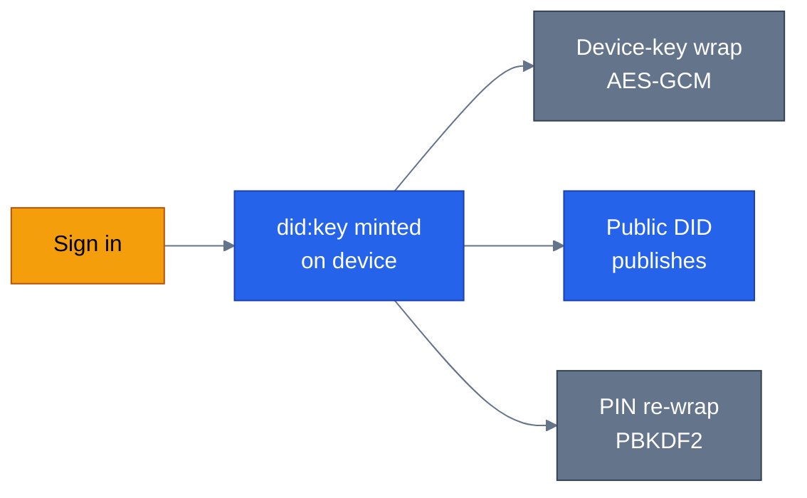

### 7.7 · Standards timeline

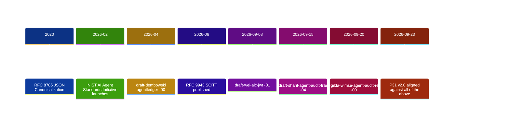

### 7.8 · Security posture

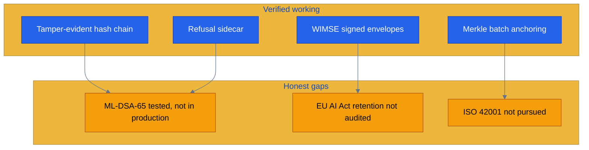

### 7.9 · Hiring journey

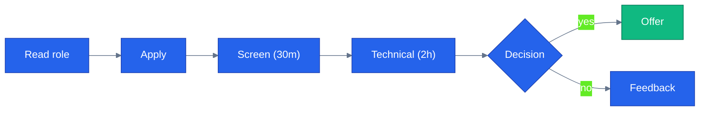

### 7.10 · Research timeline

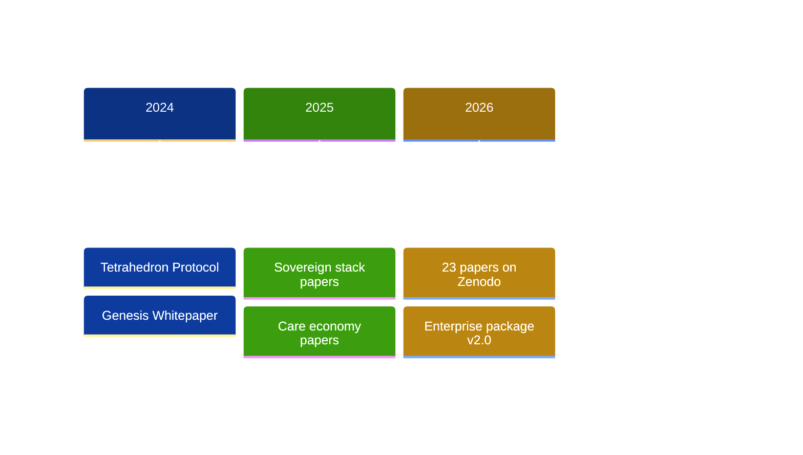

### 7.11 · Contributor flow

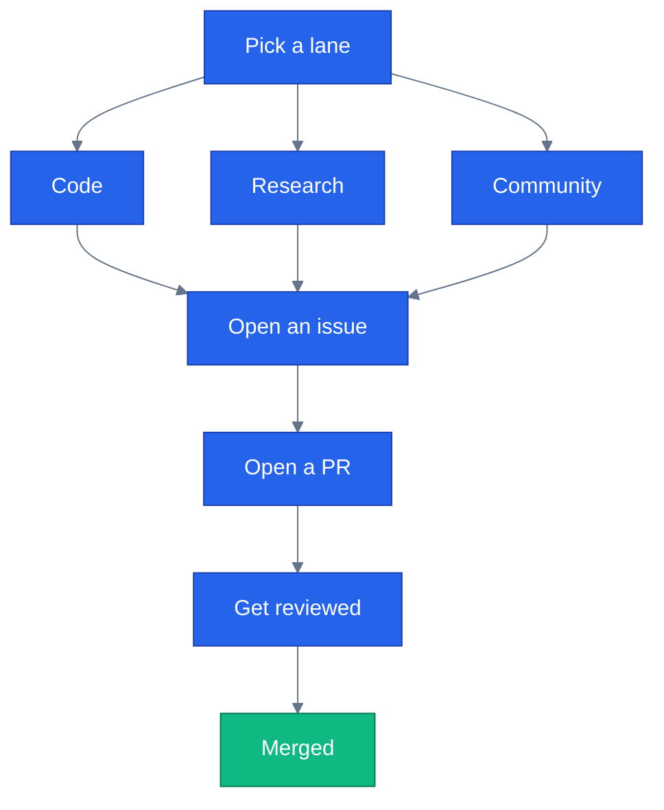

### 7.12 · Treasury flow

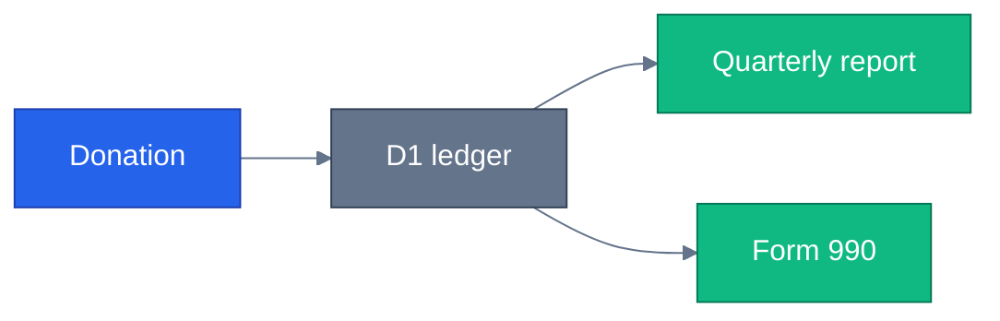

### 7.13 · Quarterly-report gantt

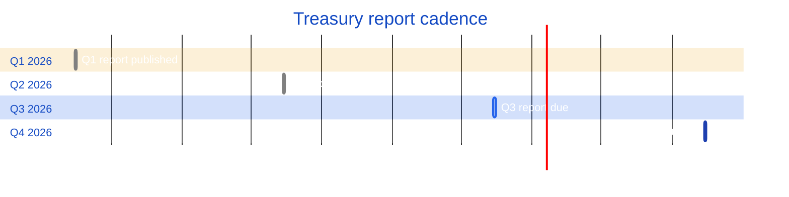

### 7.14 · Financials pie

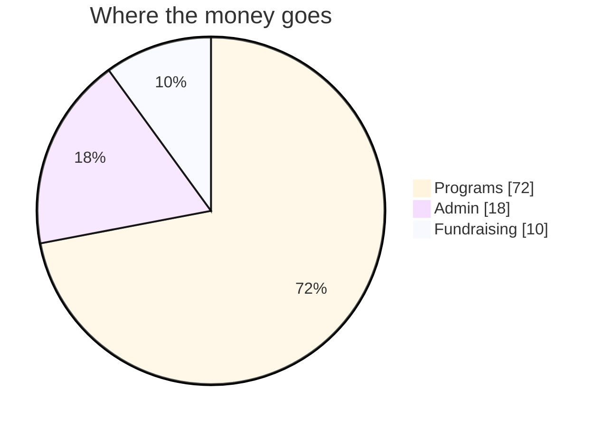

### 7.15 · Federated identity flow

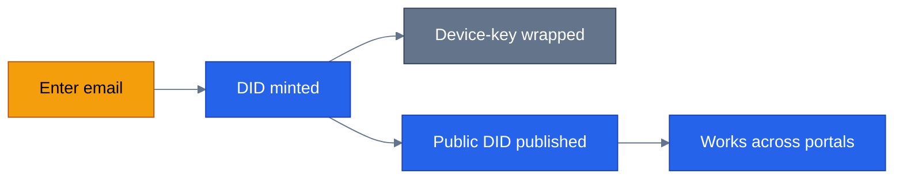

---

## 8 · The 501(c)(3) facts card

Every page that references nonprofit status reads from **one file** — `ground-truth/p31.ground-truth.json` (or a dedicated `src/data/nonprofit.ts`). Fields:

```ts
export const NONPROFIT = {
  ein: '42-1888158',
  determinationDate: '2026-04-03',
  irsLetter: '/legal/irs-determination-letter.pdf',
  state: 'Georgia',
  deductibility: 'Donations are tax-deductible to the fullest extent allowed by law.',
  ruling: '501(c)(3)',
}
```

Then `/about`, `/donate`, `/ways-to-give`, and the footer read from this — never duplicate the EIN.

---

## 9 · Gates

### Per-page (before marking done)

1. The page renders the dome + starfield.
2. Every Mermaid diagram renders in **both light and dark mode** (test by toggling `data-theme` in DevTools).
3. No hardcoded `fill:#333` or `stroke:#333` in any diagram.
4. Every DOI, EIN, Form 990, and registry link resolves.
5. The `<title>` and `<meta description>` are page-specific.
6. `pnpm build` clean; `pnpm exec vitest run` green.
7. A screenshot at **1280×800** and **375×812** confirms the page reads as itself — not the landing hero.

### Site-wide (before handoff)

1. `/faq` JSON-LD validates against schema.org's FAQPage shape.
2. `/financials` pie chart cites Form 990 as its source.
3. `/team` — every member has a bio (or an honest "bio pending").
4. `/about` leads with the story, not a dry chronology.
5. `/enterprise` renders every diagram from the package.
6. Every Mermaid diagram passes the dark/light toggle test.
7. The 501(c)(3) facts come from one file — grep for the EIN and confirm exactly one source.

---

## 10 · The `CanonTopbar` regression pattern (fixed, documented so it doesn't recur)

**The bug.** When `CanonTopbar` moved into `MarketingShell` (v2.1), any page or component that rendered `<CanonTopbar client:load />` in its own slot ended up with two stacked topbars. The `/apps/*` flagship pages (`FlagshipPage.astro`) were the one that hit it — the shell rendered one, `FlagshipPage` rendered another.

**The fix pattern.** Remove the page-level `<CanonTopbar>` and its import. Grep for it:

```bash
grep -rnE "<CanonTopbar" src/pages src/components src/layouts | grep -v "CanonTopbar.tsx"
```

**Expected output:** only `src/layouts/MarketingShell.astro` should render it. Anything else is a regression.

---

## 11 · What's explicitly out of scope

- **The control server** — parallel workstream, separate prompt at `apps/music-maker/docs/CONTROL_SERVER_BUILD_PROMPT.md`.
- **The rotation knob rescale** — a p31ca CSS change, not content; tracked separately.
- **The `_redirects` fix** — already shipped (`/_astro/* /404 404`, verified live).
- **Payment processing** — `/donate` links to the existing Stripe flow; no new payment code here.
- **CMS integration** — the content collections are file-based; a CMS (Strapi, etc.) is a later decision.
- **Analytics** — the privacy page states "none" and that's honest; adding any would need a policy update first.

---

## 12 · The build sequence (concrete)

For each page, the sequence is:

1. Write the page (or edit the existing one) — content per §2, tokens per §3, diagrams per §7.
2. If it needs new content, create the collection entry per §4.
3. Verify the gates in §9 for that page.
4. Commit, deploy (`apps/p31ca` — `npx wrangler pages deploy dist --project-name p31ca --branch=main --commit-dirty=true`).
5. Hard-refresh and confirm on the live URL.

**Start with `/about` + `/team`.** Everything downstream inherits their structure.

---

*This runbook is a reference. It doesn't build anything itself — it tells the builder what to build, with what data, and how to know when it's done.*