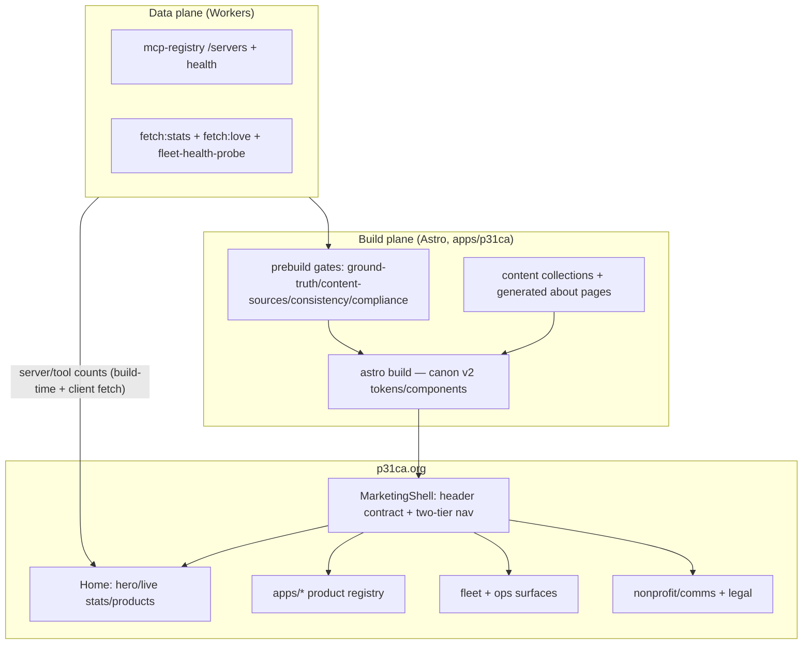

<!-- P31-HEADER
id: p31_plan_p31ca_kilo_overhaul_20261012_v1.0
type: plan
component: apps/p31ca
status: live
retention: keep-forever
created: 2026-10-12T00:00:00Z
owner: will
-->

# p31ca.org × kilo.ai — Page-by-Page Overhaul Plan

**Mission:** p31ca.org is the technical hub — the front door to the sovereign
stack. kilo.ai sets the bar: immediate proof above the fold, two-tier nav,
section rhythm, density-with-clarity. We match the bar without the marketing
funnel: our users come to *inspect and use* the ecosystem, not to be sold.

**Authorities:** `apps/p31ca/CLAUDE.md`, `RUNBOOK.md`, `DEPLOY.md`;
`production/docs/SITE-FLOW-MAP.md` + `SITE_MAP_AND_OWNERSHIP.md`;
`production/docs/plans/canon-v2-contract.md`; `.kilo/plans/frontend-rebuild-p31ca-phosphorus31/`.

## 0. Principles (research-locked)

1. **Proof above the fold** — hero = one value sentence + LIVE stats
   (servers/tools/last-checked from mcp-registry), graceful offline fallback.
2. **Two-tier nav** — primary hub nav (logo + sections + GitHub) + secondary
   product/section row. Nav height = one variable (`--p31-header-height`),
   consumed by offsets + `scroll-padding-top`. Sticky, never fixed.
3. **Section rhythm** — every section has one job: value → proof → products →
   start. No decorative cards without purpose.
4. **Density-with-clarity** — tight consistent 8–16px grid, scannable rows,
   tables over prose for fleet data.
5. **Substance with structure** — the sweet spot between "too corporate" and
   "too sparse" (our current failure mode).
6. **States teach** — every async surface owns idle/loading/success/empty/
   error; empties carry a CTA, errors name cause + fix.
7. **Plain language** — 5th-grade strings (the portal's scan standard
   extends to the hub).
8. **Canon v2 only** — `[data-p31=…]` components + patterns
   (ListingShell/DetailShell/Wizard), cascade layers
   (`legacy, canon.tokens, canon.components, canon.layout, shell, face`),
   44px control floor, fluid clamp (max ≤ 2.5×min), container queries.
   Tailwind classes migrate to `@layer legacy` during the transition and die
   per page.
9. **Anti-slop** — no purple/indigo gradients, no uniform 16px card kits,
   no zigzag columns, no nested cards, no Inter-default; the P31 quantum
   glass language carries the identity.
10. **Resilience** — hub renders under API degradation (live-stats fallback
    text is a designed state, not an error).

## 1. Architecture (kilo.ai anatomy → P31)



**Shell contract (per surface):** `BaseLayout.astro` (landing/document) +
`MarketingShell.astro` (hub home) adopt `--p31-header-height`, centered page
container (`width:100%; max-width:80rem; margin-inline:auto`), prose 65ch,
forms 33rem. Inner app-like pages use `Page mode="fill|panel-scroll"` — never
a global height-100% shell on flow pages.

**Live-stats pipeline:** registry `/servers` → `scripts/hub/fetch-*.mjs`
(build-time) → `index.astro` client island (re-fetch + offline fallback
"Couldn't check right now."). Prebuild gates keep ground truth honest.

## 2. Sitemap (current → target)

```
p31ca.org/
├── /                       HUB HOME — hero + live stats + product sections + start
├── /apps/…                 PRODUCT REGISTRY (8) — detail shells → portal deep links
│   ├── mcp                 → marketplace portal (p31-portal-mcp-marketplace.pages.dev)
│   ├── cli                 → p31-cli docs/surface
│   ├── governance          → governance engine surface
│   ├── loom / lumi / meatspace / qpj / spaceship-earth
├── /arcade                 games index (agent-playable cards)
├── /journey · /research · /enterprise · /security · /compliance
├── /about · /team · /press · /hire · /get-involved
├── /annual-report · /financials · /treasury · /donate · /ways-to-give
├── /faq · /blog[/slug] · /accessibility
├── /privacy · /terms · /signin · /signup · /404
└── generated: /about/<entity> (enriched about pages)
```

**Nav contract (never breaks):** phosphorus31.org · p31ca.org · GitHub —
visible in every header/footer.

## 3. User journeys

```mermaid
flowchart LR
  D[Developer lands] --> H[Hero: live stats] --> P[Product section] --> A[/apps/mcp detail] --> M[Marketplace portal]
  F[Family lands] --> M2[Mission sentence] --> NP[Nonprofit section] --> phosphorus31.org
  O[Operator lands] --> S[Status strip] --> OPS[Fleet/ops surfaces] --> C[command-center/status]
  W[Writer/contributor] --> G[How to start] --> GitHub
```

## 4. Page-by-page overhaul

Legend: T=Tailwind legacy · C=canon v2 · P=pattern shell · L=live data ·
`P0`=this wave · `P1`=next.

### A. Hub home + shell (P0)
| Page | Now | Target |
|---|---|---|
| `layouts/MarketingShell.astro` | overlap risk, single nav, no stats | header contract (`--p31-header-height`), two-tier nav (primary + product row), centered container, footer nav contract |
| `layouts/BaseLayout.astro` | doc layout, legacy classes | canon `Page flow` + `PageHeaderV2` + prose 65ch; scroll-padding |
| `index.astro` | sparse landing | hero sentence + LIVE stats strip + "What is P31" 3-step + product sections (cards → portal links) + how-to-start + footer. `Grid min=md`, ≤7 cards/section |
| `404.astro` | bare | `ErrorState` with CTA ("Go home" / "Browse the catalog") |

### B. Product registry `/apps/*` (P0-P1, 8 pages)
| Page | Now | Target |
|---|---|---|
| `/apps/mcp` | static text | `DetailShell`: summary row (servers/tools/last-checked, LIVE) + tabs (What it is / Try it / Install) + CTA → marketplace portal |
| `/apps/cli`, `/apps/governance`, `/apps/loom`, `/apps/lumi`, `/apps/meatspace`, `/apps/qpj`, `/apps/spaceship-earth` | static text | same `DetailShell` pattern (one-line value, live status where the surface has a health endpoint, portal deep link) |
| `/arcade` | list | `ListingShell`: card grid of playable games, each card = name + one-liner + Play |

### C. Fleet + ops surfaces (P1)
| Page | Now | Target |
|---|---|---|
| fleet/ops pages (spaceship-earth, status links) | worker-HTML or static | consume `fleet-health-probe` output → status table rows (dense, 8px grid) + last-checked timestamps; `Skeleton` while loading; `ErrorState` with retry |
| `/compliance`, `/security` | prose | prose + status summary rows (audit posture from SSOT docs), no marketing veneer |

### D. Nonprofit/comms (P1)
| Page | Now | Target |
|---|---|---|
| `/about`, `/team` (3 members + generated), `/press`, `/hire`, `/get-involved`, `/journey`, `/research`, `/enterprise` | prose, legacy | `Page flow` + `PageHeaderV2`; one-line purpose each; team = card grid (plain names/titles, p31-icon-pack); keep generated about pages working through `hub:ci` |
| `/annual-report`, `/financials`, `/treasury`, `/donate`, `/ways-to-give` | tables/prose | dense-but-legible tables (8px rows), single primary CTA per page (Donate), honest numbers only |

### E. Legal/auth (P1)
| Page | Now | Target |
|---|---|---|
| `/privacy`, `/terms`, `/accessibility`, `/faq` (16 entries) | prose | prose 65ch, FAQ = `ListingShell`/accordion with search; plain-language pass on all 16 entries |
| `/signin`, `/signup` | legacy forms | canon `Field`/`Input` (44px floor), one primary action, error state names cause+fix |
| `/blog` (2 posts) + content collections | md | keep collections; post layout = `Page flow` + prose + reading-progress optional |

## 5. Doc updates

| Doc | Change |
|---|---|
| `apps/p31ca/RUNBOOK.md`, `CLAUDE.md`, `DEPLOY.md` | add: canon v2 consumption contract, header-height variable, live-stats pipeline, gate list (render-gate on hub routes, plain-language scan, prebuild chain), deploy = `npm run prebuild && npm run build && npm run deploy` |
| `production/docs/SITE-FLOW-MAP.md` | update surface #1: two-tier nav, 54→(35 static + collections + generated), canon v2 stack, live-stats source |
| `production/docs/SITE_MAP_AND_OWNERSHIP.md` | add hub↔portal deep-link map (`/apps/mcp` → marketplace portal, etc.) |
| `.kilo/plans/frontend-rebuild-p31ca-phosphorus31/` | supersede with this doc (add a pointer in 00-QUICKSTART) |
| `production/docs/plans/canon-v2-contract.md` | add hub as face #1 of the face-contract manifest (id `hub`, route `/`, mode `flow`, regions, spoon cost, lifecycle → audit ledger) |
| NEW `apps/p31ca/docs/UPGRADE-PLAN-KILO.md` | this plan (landed) |
| NEW `apps/p31ca/docs/UPGRADE-RUNBOOK-KILO.md` | the operational twin: phases H1–H6, gates, rollback, SLA, decisions (landed) |

## 6. Execution order

1. **H1** (in flight): canon header-height + centering contract (hub inherits).
2. **H2b** (in flight): hub density on the CURRENT stack (shell fix + hero +
   live stats + two-tier nav + product sections) — proves the design before
   the upgrade.
3. **H3 upgrade**: Astro 5.17 → current major, `@astrojs/*` bumps, React
   18.3 → 19, TS 7 stays; Tailwind decision → **collapse to canon v2 tokens**
   (Tailwind classes → `@layer legacy` per page as each is ported; full
   removal tracked per section, exclusion list already exists in
   `scripts/style-alignment-exclude.json`).
4. **H4 page port**: sections A → B → C → D → E in that order; each page
   flips from Tailwind-legacy to canon and deletes its legacy CSS.
5. **H5 gates**: extend render-gate to hub routes (`/`, `/apps/mcp`, one
   fleet page) at 3 viewports × themes; plain-language scan on hub strings;
   `prebuild` chain stays the deploy gate.
6. **H6 face contract**: hub registers as the first face in the face-contract
   manifest; lifecycle events → audit ledger (`action_class: hub`).

## 7. Definition of done

- Hub home answers *what / what can I do / what next* in the first viewport
  with live stats and an offline fallback state.
- Every page: canon v2 shell + one purpose sentence + one primary action.
- Render-gate green on hub routes; prebuild chain green; plain-language
  scan green; nav contract intact; deploy to Pages project `p31ca`.