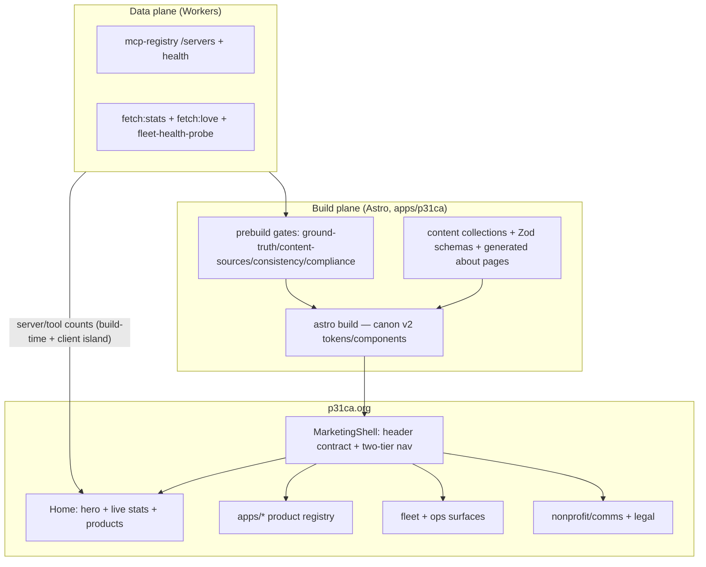
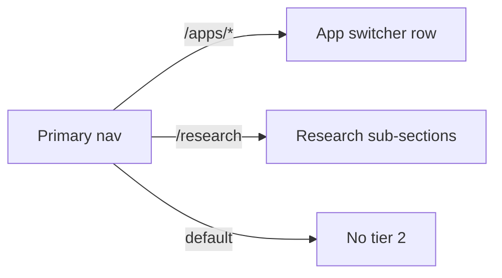

<!-- P31-HEADER
id: p31_runbook_p31ca_kilo_overhaul_20261012_v1.0
type: runbook
component: apps/p31ca
status: live
retention: keep-forever
created: 2026-10-12T00:00:00Z
owner: will
-->

# p31ca.org × kilo.ai — Enterprise Overhaul Runbook

**Document ID:** p31_runbook_p31ca_kilo_overhaul_20261012_v1.0
**Sibling:** `docs/UPGRADE-PLAN-KILO.md` (the page-by-page plan; this runbook
is its operational twin — phases, gates, rollback, SLA, decisions).

## 0. Mission & authorities

Rebuild p31ca.org from a sparse technical hub into a kilo.ai-class developer
hub — **proof above the fold, two-tier nav, section rhythm,
density-with-clarity** — without the marketing funnel. Users come to inspect
and use the sovereign stack, not to be sold to.

**Authorities (in order):** `apps/p31ca/{CLAUDE,RUNBOOK,DEPLOY}.md` ·
`production/docs/SITE-FLOW-MAP.md` + `SITE_MAP_AND_OWNERSHIP.md` ·
`production/docs/plans/canon-v2-contract.md` ·
`production/docs/enterprise/design-system/canon-v2.md` ·
`.kilo/plans/frontend-rebuild-p31ca-phosphorus31/` (superseded).

**Hard constraints:** canon v2 only (`[data-p31=…]`, layers, 44px control
floor, fluid clamp max ≤ 2.5×min, container queries) · no global height-100%
shell on flow routes · 5th-grade plain language · nav contract
(phosphorus31.org · p31ca.org · GitHub in every header/footer) · hub renders
under API degradation (stats fallback is a designed state) · **no invented
stats** — every number is live or documented.

## 1. Architecture

### 1.1 System flow



**One-hero-one-island rule:** exactly one client island hydrates the stats
block; the rest of the home page is static Astro output.

### 1.2 Shell contract

```css
:root {
  --p31-header-height: 64px;
  --p31-page-max: 80rem;
  --p31-prose-max: 65ch;
  --p31-form-max: 33rem;
}
html { scroll-padding-top: var(--p31-header-height); }
[data-p31="shell-main"] { padding-top: var(--p31-header-height); }
[data-p31="page"][data-mode="flow"] {
  width: 100%;
  max-width: var(--p31-page-max);
  margin-inline: auto;
  padding-inline: var(--p31-page-pad-x);
}
```

Topbar is `position: sticky` (never fixed) — it occupies flow, so the padding
is the only offset. Fixed headers are forbidden on app pages.

### 1.3 Live-stats pipeline

```
registry /servers → scripts/hub/fetch-*.mjs (build-time) → index.astro island
                                                            ↓
                                          re-fetch + last-known-good fallback
                                          ("Checked 2 min ago" timestamp, not
                                           a bare error)
```

## 2. Sitemap

### 2.1 Current inventory

35 static pages + 16 FAQ entries + 2 blog posts + 3 team members + generated
about pages (see `UPGRADE-PLAN-KILO.md` §2 for the full tree).

### 2.2 Target sitemap

```
p31ca.org/
├── /                        HUB HOME — hero + live stats + product sections + start
├── /apps/…                  PRODUCT REGISTRY (8) — DetailShell → portal deep links
│   ├── mcp → marketplace portal · cli · governance · loom · lumi · meatspace · qpj · spaceship-earth
├── /arcade                  ListingShell — playable-game cards
├── /journey · /research · /enterprise · /security · /compliance
├── /about · /team · /press · /hire · /get-involved
├── /annual-report · /financials · /treasury · /donate · /ways-to-give
├── /faq (accordion + search) · /blog[/slug] · /accessibility
├── /privacy · /terms · /signin · /signup · /404 (ErrorState + CTA)
└── generated: /about/<entity>
```

### 2.3 Navigation contract (two-tier)

- **Tier 1 (primary):** logo + sections (Apps · Research · Enterprise ·
  About) + GitHub + Sign In. Sticky; height = `--p31-header-height`.
- **Tier 2 (contextual):** per-section row — on `/apps/*` the app switcher;
  on `/research` the research sub-sections. Modeled on kilo-docs' per-section
  nav config (`lib/nav/*` NavSection pattern). CSS-first via `flex-wrap +
  order`; mobile falls to the bottom tab bar; dropdowns are `<details>`.



## 3. User journeys

```mermaid
flowchart LR
  D[Developer] --> H[Hero + live stats] --> P[Product section] --> A[/apps/mcp DetailShell] --> M[Marketplace portal]
  F[Family] --> M2[Mission sentence] --> NP[Nonprofit section] --> phosphorus31.org
  O[Operator] --> S[Status strip] --> OPS[Fleet/ops surfaces] --> command-center
  W[Contributor] --> G[How to start] --> GitHub
```

Journey principles: proof above the fold · each section one job
(value → proof → products → start) · density-with-clarity · substance with
structure.

## 4. Page-by-page overhaul

Full tables live in `UPGRADE-PLAN-KILO.md` §4. Runbook summary:

| Section | Pages | Pattern | Priority |
|---|---|---|---|
| Home + shell | `index`, `MarketingShell`, `BaseLayout`, `404` | hero + live stats + 3-step + products; ErrorState CTA | P0 |
| Product registry | `/apps/*` ×8, `/arcade` | DetailShell (summary row live + tabs + portal CTA); ListingShell | P0–P1 |
| Fleet/ops | spaceship-earth, status links, `/compliance`, `/security` | dense status tables (8px grid) + Skeleton + ErrorState retry | P1 |
| Nonprofit/comms | about/team/press/hire/get-involved/journey/research/enterprise/financials/treasury/donate/ways-to-give/annual-report | Page flow + PageHeaderV2, one purpose sentence, single primary CTA | P1 |
| Legal/auth | privacy/terms/accessibility/faq/signin/signup/blog | prose 65ch; canon Field/Input; plain-language pass on all 16 FAQ | P1 |

**Home composition** (kilo.ai anatomy minus the funnel):

```
HERO: one value sentence + LIVE stats (16 servers · 240 tools · checked 2 min ago)
      CTAs: [Deploy your own] [GitHub] [Start for your family]
WHAT IS P31: 3-step strip (identity · care economy · open source)
PRODUCTS: Grid min=md, ≤7 cards, each = name + one-liner + Open → portal
HOW TO START: one command + copy button
FOOTER: phosphorus31.org · p31ca.org · GitHub
```

## 5. Composition density standards

| Page type | Density rule | Section count | Card limit |
|---|---|---|---|
| Hub home | hero + stats + 3 product sections + start | 4–5 | ≤7/grid |
| Product detail | summary + tabs + action | 3 | — |
| Fleet/ops | table-first, dense rows | 2–3 | — |
| Nonprofit prose | one purpose sentence + content | 2–4 | ≤5 |
| Legal/FAQ | prose 65ch + accordion | 2 | ≤16 items |

Density limits (LobeHub): hero = 1 tag + headline (≤2 lines) + subhead
(≤2 lines); card sections = heading + 3 cards (icon + title + 2-line
description). Progressive density: information density increases top-to-bottom.

**Anti-slop checklist:** no purple/indigo gradients (P31 quantum glass carries
identity) · no uniform 16px card kits · no zigzag >2 · no nested cards · no
side-stripe >1px · no Inter-default (Atkinson Hyperlegible body, JetBrains
Mono code) · no invented stats.

## 6. Doc updates

| Doc | Change |
|---|---|
| `apps/p31ca/RUNBOOK.md` | add: canon v2 consumption contract, header-height var, live-stats pipeline, gate list, deploy = `prebuild && build && deploy` |
| `apps/p31ca/CLAUDE.md` | UI Facelift Protocol → points at this runbook + page plan |
| `apps/p31ca/DEPLOY.md` | Astro v6 + Node 22.12 migration steps |
| `production/docs/SITE-FLOW-MAP.md` | surface #1: two-tier nav, canon v2 stack, live-stats source, page counts |
| `production/docs/SITE_MAP_AND_OWNERSHIP.md` | hub↔portal deep-link map |
| `.kilo/plans/…/00-QUICKSTART.md` | supersede pointer (landed) |
| `production/docs/plans/canon-v2-contract.md` | hub = face #1 of the face contract |
| NEW `apps/p31ca/docs/UPGRADE-PLAN-KILO.md` | page-by-page plan (landed) |
| NEW `apps/p31ca/docs/UPGRADE-RUNBOOK-KILO.md` | this runbook (landed) |

## 7. Execution order

**H1 — Header-height + centering contract** (canon; in flight)
Deliverable: `--p31-header-height` token, sticky-not-fixed, offsets +
`scroll-padding-top`, centering chain; render-gate A7/A8 assertions.

**H2 — Hub density on current stack** (in flight)
Shell fix + hero + live stats + two-tier nav + product sections; marketplace
density deltas. Gate: plain-language + cognitive-load green; offline fallback
proven.

**H3 — Astro upgrade + Tailwind collapse**
Astro 5.17 → 6.x with the v6 checklist: **Node ≥ 22.12** (18/20 dropped;
`.nvmrc`) · Vite 7 dev/build · `emitESMImage()` → `emitImageMetadata()` ·
`Astro.glob()` → `getCollection()`/`import.meta.glob()` · legacy content
collections removed → migrate to Content Layer API (use
`legacy.collectionsBackwardsCompat` only as a temporary helper) · Zod 4 ·
`@astrojs/*` bumps (tailwind 6, react v6 — the hub's `patch-astrojs-react`
script exists for the React 19 pairing) · React 18.3 → 19 · TS 7 stays.
Tailwind 3.4 classes → `@layer legacy` per page as each ports; full removal
tracked per section (`scripts/style-alignment-exclude.json` already exists).
Gate: prebuild chain green · `pnpm typecheck/lint/test/build/v:gate` green ·
render-gate green on hub routes.

**H4 — Page port, section by section**
A (home+shell) → B (registry) → C (fleet/ops) → D (nonprofit) → E
(legal/auth); each page flips Tailwind-legacy → canon and deletes its legacy
CSS.

**H5 — Gates + deploy**
Render-gate on hub routes (`/`, `/apps/mcp`, one fleet page) at 3 viewports ×
themes; plain-language scan on hub strings; prebuild chain stays the deploy
gate. Deploy: `npx wrangler pages deploy dist --project-name p31ca
--branch=main --commit-dirty=true`.

**H6 — Face contract**
Hub registers as face #1: `{ id: hub, route: /, nav_entry: home+icon, mode:
flow, regions: hero/stats/products/start, capabilities: live-stats/
portal-links/fleet-status, spoon_cost: low, lifecycle: hub:loaded,
hub:stats_refreshed, hub:product_opened → audit ledger (action_class: hub) }`.

## 8. Definition of done

- [ ] Home answers what / what can I do / what next in the first viewport,
      with live stats and a designed offline fallback.
- [ ] Every page: canon v2 shell + one purpose sentence + one primary action.
- [ ] Topbar overlap resolved at 375/768/1280; content centered
      (max-width 80rem, prose 65ch, forms 33rem).
- [ ] No page "too sparse" — every section has a job.
- [ ] Render-gate green on hub routes; prebuild chain green; plain-language
      scan green; nav contract intact.
- [ ] Deployed to Pages project `p31ca`; live 200.

## 9. Rollback & incident response

- **Build failure:** `pnpm typecheck` locally; check Astro config + missing
  imports; fix commit, re-run.
- **Deploy failure:** verify `CLOUDFLARE_API_TOKEN`/`CLOUDFLARE_ACCOUNT_ID`;
  Cloudflare Dashboard → Workers & Pages → `p31ca` → Deployments → rollback
  to previous deployment.
- **Runtime errors:** hit health endpoint; roll back if the latest deploy
  caused it.
- **Stale content:** hard refresh — service worker is network-first (fixed
  2026-10-12), no stale-cache risk.

| Severity | Response | Escalation |
|---|---|---|
| SEV1 site down | 15 min | on-call → deploy rollback |
| SEV2 feature broken | 1 h | on-call → PR fix → deploy |
| SEV3 minor | 24 h | triage → next sprint |
| SEV4 question | 72 h | team chat → docs update |

## 10. Open decisions (recommendations locked-in unless overridden)

1. **Tailwind collapse** — collapse to canon v2 tokens (Tailwind classes →
   `@layer legacy` per page). Recommended: collapse.
2. **Two-tier nav** — CSS-first (`flex-wrap + order`, `<details>` dropdowns,
   mobile bottom tab bar). Recommended: CSS-first.
3. **Stats fallback** — last-known-good numbers + "checked N ago" timestamp
   (not a bare error). Recommended: last-known-good.