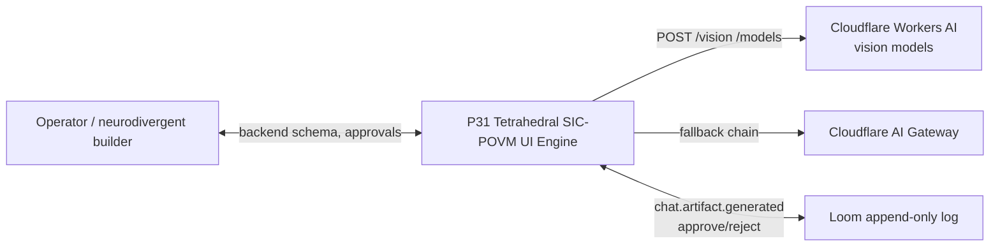
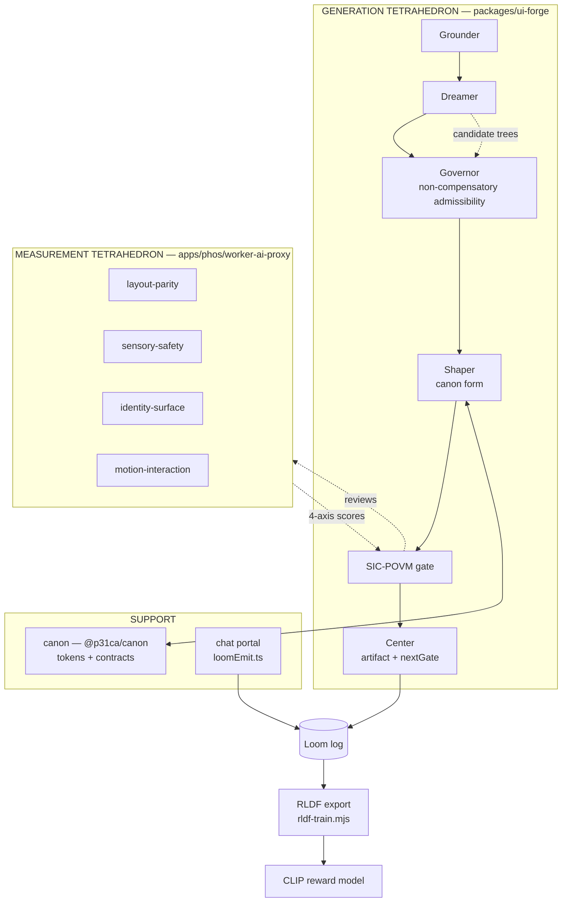

# Architecture Overview — C4 Context & Container

C4 levels used: **System Context** (for a non-engineer) and **Container** (for
an engineer). Level 4 (Code) is not maintained here — read the source directly.

## Level 1 — System Context

**The engine** accepts a backend spec (OpenAPI / Prisma / GraphQL / entity
list) and produces a P31 quantum material-styled frontend, gated on
informational completeness. It measures a UI across four SIC-POVM axes and
refuses deploy when any axis collapses or a critical finding is corroborated.

## Level 2 — Container

## Containers

| Container | Location | Role |
|---|---|---|
| ui-forge (generation tetrahedron) | `packages/ui-forge` | Grounder→Dreamer→Governor→Shaper→Center, gate, retry, schema gen |
| worker-ai-proxy (measurement tetrahedron) | `apps/phos/worker-ai-proxy` | `/vision` + `/models`, cross-model fallback, validate-before-cache |
| mcp-registry | `workers (1)/mcp-registry` | Agent catalog (vision-reviewer, vision-layout, vision-sensory, vision-identity) |
| swarm-router | `workers (1)/swarm-router` | K₄ topology V1–V5; `/api/vision/*` → `/vision` |
| canon | `packages/canon` | Typed tokens, contracts, DTCG export, Loom |
| chat portal | `portals/chat` | Artifact surface + `loomEmit.ts` screenshot capture |
| design-parity tools | `tools (1)/design-parity` | `visual-gate.mjs` (deploy precheck), `slop-judge.mjs`, `parity-server.mjs` |

## Deployed endpoints (verified 2026-10-02)

- `https://phos-ai-proxy.trimtab-signal.workers.dev` — `/health`, `/vision`,
  `/models`, `/transcribe`, chat `/`
- `https://mesh.p31ca.org` — swarm-router (V1–V5); `/api/vision/*` rewrites to
  `/vision`

## Key decisions

| # | Decision | ADR |
|---|---|---|
| 1 | SIC-POVM as the truth layer (incl. 1/3-overlap corroboration) | [adr/0001](../adr/0001-sic-povm-as-truth-layer.md) |
| 2 | Two nested tetrahedra | [adr/0002](../adr/0002-two-nested-tetrahedra.md) |
| 3 | THAKI path over fine-tuning | [adr/0003](../adr/0003-thaki-path-over-fine-tuning.md) |
| 4 | Non-compensatory Governor | [adr/0004](../adr/0004-non-compensatory-governor.md) |
| 5 | RLDF CLIP reward model | [adr/0005](../adr/0005-rldf-clip-reward-model.md) |
| 6 | Cross-model fallback chain | [adr/0006](../adr/0006-cross-model-fallback-chain.md) |