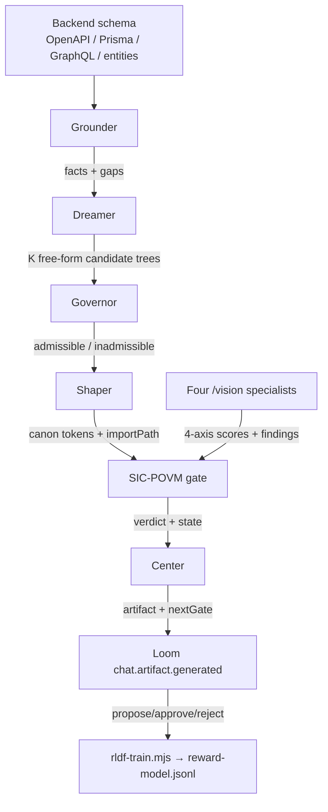
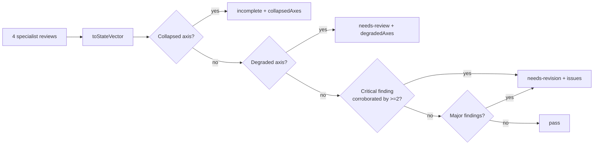

# The Tetrahedral Engine

The engine is **two nested tetrahedra**. The generation tetrahedron proposes;
the measurement tetrahedron verifies; the SIC-POVM gate connects them on
informational completeness.

## Data flow

## The generation tetrahedron

Each vertex is a **separate agent** — this is the documented requirement of the
Tetrahedral Agent Protocol: "one mind doing all four collapses them into mush,
because they have opposing instincts."

| Vertex | Module | Job | Resists |
|---|---|---|---|
| Grounder | `src/grounder.mjs` | Backend schema → verified facts + gaps; Socratic questions for gaps (λ-weighted for neurodivergent load) | Filling gaps with plausible guesses |
| Dreamer | `src/dreamer.mjs` | K free-form candidate component trees; token-map prompt so candidates are admissible | Converging, self-censoring |
| Governor | `src/governor.mjs` | Non-compensatory admissibility: unknown type / no binding / token violation → inadmissible | Agreeable slop, "pretty idea" protection |
| Shaper | `src/shaper.mjs` | Repairs candidates against the canon: clamp enums, drop undeclared props, enforce `p31.*` tokens, map importPath/cssClass | Adding new ideas |
| Center | `src/center.mjs` | Orchestrates; emits artifact + named `nextGate` | Wearing any vertex's hat |

### Non-compensatory admissibility

The Governor is a **falsifier, not a ranker** (see
[adr/0004](../adr/0004-non-compensatory-governor.md)). Rules are ANDed; one
violation flips the candidate:

1. **Unknown type** — every node `type` must be in the closed component enum.
2. **No binding** — the tree must bind to ≥1 grounded entity or action
   (`bindingScore ≥ 0.5`). A clean-but-inert surface is inadmissible.
3. **Token violation** — every token must be `p31.*`-namespaced AND in that
   component's allowed contract.

The Center then picks among **admissible** survivors by the deterministic score
(a tie-break, never a judge).

## The SIC-POVM gate

`src/gate.mjs` — pure, deterministic, no LLM on the critical path. The four
axes are the SIC-POVM effects; the design state is the 4-vector
`p_j = mean_j / 10`.

### Completeness
`FLOOR = 0.4` → mean ≥ 4/10 on every axis. A collapsed or missing axis is an
incomplete state (informationally complete semantics — an unmeasured axis is
not a default pass).

### 1/3-overlap corroboration
`MIN_CORROBORATORS = 2`. A `critical` finding only gates when ≥2 specialists
independently flag the same issue. One lone critic does not collapse the
design. This is the discrete analog of the equiangular overlap.

### QBism belief update
`beliefDelta(prev, next)` = ‖Δp‖; `atEquilibrium` halts the loop when
`‖Δp‖ < ε` (0.05). The design state is the shared belief of the four
specialists. (History storage is a known gap — see STATUS.md.)

### Degraded semantics
A review with `degraded:true` (instrument fault: fallback model/rubric, or the
neutral `unmeasured`) yields `needs-review`, never a silent pass. This is QBism
confidence: a known-instrument-fault measurement updates the belief with lower
confidence.

## The measurement tetrahedron

Four `/vision` specialists measure the same design state across four axes:

| Axis | Focus | Maps to |
|---|---|---|
| `layout-parity` | Structure — rail proportion, brand, primary action | structure axis |
| `sensory-safety` | Coherence — ambient subordination, text contrast | coherence axis |
| `identity-surface` | Sovereignty — user chip, DID legibility | sovereignty axis |
| `motion-interaction` | Interaction — focus rings, loading signals | interaction axis |

The specialists share ONE slop vocabulary — the **AHD 39-tell taxonomy**
(`packages/ui-forge/src/slop-taxonomy.mjs`), mapped per axis. Measured slop
reduction from AHD is 61–78% across models. The taxonomy is the moat; the
package is an implementation detail.

Reliability (see [adr/0001](../adr/0001-sic-povm-as-truth-layer.md) and the
vision runbook):
- **Cross-model fallback**: llama → gemma → qwen → DEFAULT_RUBRIC.
- **Neutral failure**: all-models-fail returns `{ mean: 5, verdict:
  'unmeasured', degraded: true }` (HTTP 200) + `X-P31-Degraded: true`.
- **Validate-before-cache**: only `mean ∈ [0,10]` + present verdict is cached.

## Center — the closed loop

The Center maps the gate verdict to named next actions:

| Axis | Named action |
|---|---|
| `layout-parity` | rebalance rail proportion; promote primary action; re-group threads |
| `sensory-safety` | reduce ambient opacity below 0.35; raise text contrast; enable reduced-motion |
| `identity-surface` | restore user-chip legibility; raise DID to tertiary contrast; fix pre-mint |
| `motion-interaction` | add focus rings; define pressed states; signal composer loading/stop |

The loop closes with "fix this", not "it failed".