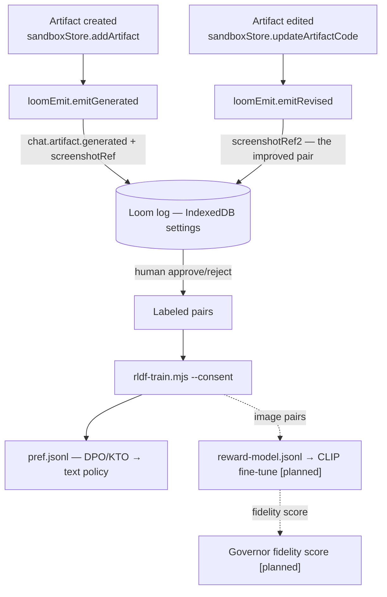

# The Training Loop — RLDF + Loom substrate

The engine is **trainable** — the operator's approvals and rejections are the
reward signal. The substrate is the Loom's append-only event log.

## Architecture

**Legend:** solid lines + plain nodes = shipped today; dashed lines + nodes
marked `[planned]` = not built yet. The reward model and its feedback into the
Governor are **planned** — the export harness ships, but no CLIP fine-tune has
run (no training data yet; PNG capture pending).

## Loom v1.2 screenshot refs

`chat.artifact.generated` (agent) carries:
- `screenshotRef` — the rendered artifact key (R2 or content hash).
- `screenshotRef2` — the operator-improved version, forming the
  (original, improved) **pair** the CLIP reward model trains on.

This is an **additive** extension of the frozen v1 union — new optional members
only, nothing retyped (see `packages/canon/docs/REFUSE-KIND-EXTENSION.md`).
Privacy: `shared`-scope events only, `personal` never eligible; `--consent` is
a hard gate on export.

## The three layers

| Layer | Output | Method | Status |
|---|---|---|---|
| **Image-pair reward model** | `reward-model.jsonl` | CLIP fine-tune (Apple RLDF): (rendered image, description) → score | **PLANNED** — export harness ships; no fine-tune run, no image pairs yet |
| **Text policy** | `pref.jsonl` | DPO pairs / KTO single-signal from propose→approve/reject | SHIPPED (export) |
| **Parameter-free replay** | Loom memory fold + `retrieveReplay` | Deterministic retrieval, no weights change | SHIPPED |

## Capture status

The chat portal's `loomEmit.ts` captures the **serialized rendered fragment**
(HTML) today, because the preview iframe is opaque-origin sandboxed
(`sandbox="allow-scripts allow-modals"` — no `allow-same-origin`), so the
parent cannot canvas-capture it. The fragment feeds the DPO/KTO text-policy
layer now. PNG capture (html-to-image or in-iframe canvas + `postMessage`) is
**planned** — see STATUS.md.

Verified: `saveSetting`/`loadSetting` and the `settings` IndexedDB store exist;
the chat suite (76 tests) passes with the loom wiring in place.

## Governance

- **Consent is a gate, not a checkbox** — `--consent` must be passed or no
  training data is produced (COPPA / People-First posture).
- **Shared scope only** — `personal` events are replay-only, never fine-tuning.
- **Acceptance is the label** — `chat.artifact.approve` = positive,
  `chat.artifact.reject` = negative.
- The full fine-tune path (QLoRA on a 360M–3B base, GGUF → llama.cpp) is
  documented in `packages/canon/docs/LUMI-TRAINING.md`.