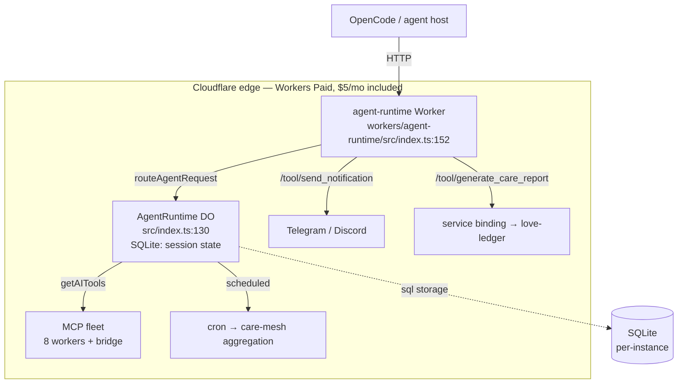
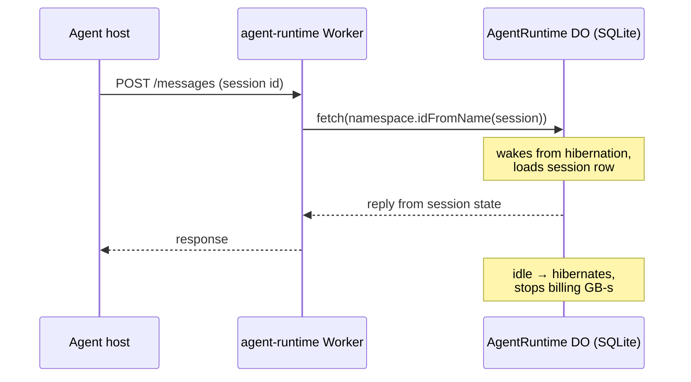

<!-- P31-HEADER
id: p31_agent_runtime_durable_objects_20261013_v1.0
type: research
component: workers/agent-runtime
status: live
retention: keep-forever
created: 2026-10-13T00:00:00Z
owner: will
-->

# Agent runtime on Durable Objects — the P31 reference architecture

Status: **accepted (reference)**. This document is the estate-wide reference
for where agent state lives: session state in SQLite-backed Cloudflare
Durable Objects, with the included-allowance math stated against the two
credible alternatives (DigitalOcean Agent Droplets, AWS Bedrock AgentCore).
All pricing numbers carry citations (accessed 2026-10-13).

## 1. The decision

Every long-lived agent session — conversation state, tool state, task
dispatches, evidence vaults, game rooms — lives in a **Durable Object (DO)**:
a single-threaded, strongly consistent object with SQLite storage, addressed
by a stable id, that hibernates when idle and wakes on the next request.

Why DOs instead of a self-managed server:

| Property | Durable Object | VM (Droplet/EC2) |
|---|---|---|
| Concurrency model | Single-threaded per object — no locks needed | Locks, queues, races by default |
| Storage | SQLite per object, point-in-time restore | You provision and back it up |
| Idle cost | Hibernates; inactive objects bill ~nothing | The VM bills 24/7 |
| Scaling unit | One object per session — isolates failures | Whole host |
| Request floor | 1M DO requests/mo + 400k GB-s/mo **included** on the $5/mo Workers Paid plan | Every hour is paid |

The single-threaded guarantee is the load-bearing property: a session object
serializes its own mutations, so agent code never has to defend against its
own writes racing — the same reason the estate's ledgers are DOs
(§4).

## 2. Reference architecture

The runtime worker (`workers/agent-runtime`) is thin: plain-HTTP tool paths
are served from the entry `fetch` (`src/index.ts:153`), while the
`AgentRuntime` class (`src/index.ts:130`, an Agents-SDK `Agent`, a SQLite DO —
`wrangler.toml:13` `new_sqlite_classes = ["AgentRuntime"]`) retains durable
per-instance state + scheduling. The session lifecycle:

## 3. What goes in the SQLite DO

- **Session state**: message history, current tool state, scratchpads —
  one row-set per session id (`idFromName(sessionId)`).
- **Care/task state**: the `Agent` class retains D1-`sql` + scheduling hooks
  for the care-mesh (agent-runtime `RUNBOOK.md`, `src/index.ts:129`).
- **Consensus/ledger state**: where the estate needs a chain that cannot fork,
  the same DO pattern holds the chain (§4).

What does **not** go in the DO: model weights, hot caches, and anything that
must be shared across all sessions (that stays in D1/KV or a separate
service). One DO per session isolates a runaway session's blast radius to
itself.

## 4. The estate already runs this pattern

Real DOs in the P31 estate (all in `workers/`, all SQLite-backed where noted):

| DO class | File:line | Role |
|---|---|---|
| `AgentRuntime` | workers/agent-runtime/src/index.ts:130 (+ wrangler.toml:13) | Agent session state (Agents SDK `Agent`) |
| `MarketplaceCatalogDO` | workers/marketplace-catalog/src/index.ts:63 (SQLite `sql.exec` at :71) | Listings/offers/trades/escrow state |
| `LedgerLog` | workers/mcp-registry/src/ledger-do.ts:18 | Audit + transparency hash chains (single-writer, no-fork) |
| `SignalingRoom` | workers/bros/src/index.ts:280 | Care signaling rooms |
| `TaskDispatchDO` | workers/dads/src/index.ts:327 | EigenTrust task dispatch |
| `EvidenceVaultDO` / `EscrowEngineDO` | workers/p31-justice-hub/src/index.ts:238 / :315 | Evidence chain + 2-of-3 escrow |
| `LoveTransactionDO` | workers/love-ledger/src/index.ts:1060 | LOVE minting ledger |
| `PassportDO` | workers/p31-passport/src/passport-do.ts:18 | Identity passports |
| `SandboxDO` | workers/terminal-relay/src/sandbox-do.ts:9 | Terminal sandboxes |
| `GameSessionDO` | workers/shadow-bridge/src/game-session-do.ts:31 | Game sessions |

The conformance badge this wave ships (registry `conformance` field,
`probeConformance` in workers/mcp-registry/src/index.ts) follows the same
shape: the badge is **derived data with a TTL**, not curated prose — Law 7
(prose is advice, sensors are enforcement).

## 5. Included-allowance math (Workers Paid, $5/mo)

Sources: Cloudflare Durable Objects pricing
(developers.cloudflare.com/durable-objects/platform/pricing) — accessed
2026-10-13.

| Meter | Included on Paid | Overage |
|---|---|---|
| DO requests | **1,000,000 / month** | $0.15 / million |
| DO GB-s (duration) | **400,000 GB-s / month** | $12.50 / million |
| DO SQLite storage | 1 GB free | $0.20 / GB-month |

Worked example — one agent turn ≈ one request, 128 MB live for ~2 s
(0.25 GB-s):

- **1M turns/month**: 1M requests (included) + 250k GB-s (included) → **$5.00**
  flat.
- **2M turns/month**: +$0.15 request overage, 500k GB-s → 100k overage GB-s ≈
  **$1.25** → **≈ $6.40**.
- **10M turns/month**: 9M × $0.15 = $1.35; 2.5M GB-s → 2.1M overage ≈ $26.25
  → **≈ $32.60**.

Honest caveats: (a) GB-s bills for the time the instance is *active in
memory* — a long-lived hot session pays wall-clock memory, hibernation is
what makes the idle case cheap; (b) per-request CPU time is capped (30 s CPU
per DO request on Paid) — the DO pattern is for many short agent turns, not
few long compute-heavy ones; (c) these are the raw platform meters — model
inference, egress, and D1 are billed separately on every platform in §6 too.

### Alternative 1 — DigitalOcean Agent Droplets

Launched **2026-10-01** (DigitalOcean investor release +
digitalocean.com/blog/introducing-agent-droplets): flat monthly bundles —

| Plan | Price | Note |
|---|---|---|
| Pro | **$50 / month** | 15% discount — covers ≈ $58.82 of list usage |
| Team | **$200 / month** | 20% discount, unlimited agents and seats |

Honest comparison: at the 1M-turn scale, Workers Paid ($5) is **10× cheaper**
than the Pro bundle before overages. Agent Droplets win when the workload is
a persistent always-on process (a VM that never hibernates, custom binaries,
GPU-less but fixed RAM you want reserved) — and they cap spend, which the
metered platforms do not. They lose on idle billing (the VM bills 24/7) and
on the per-session isolation that DOs give for free.

### Alternative 2 — AWS Bedrock AgentCore

Runtime microVMs (aws.amazon.com/bedrock/agentcore/pricing):

| Meter | Rate |
|---|---|
| Runtime CPU (v1) | **$0.0895 / vCPU-hour** |
| Runtime memory (v1) | $0.00945 / GB-hour |
| Billing granularity | per second, 128 MB memory floor |

Honest comparison: AgentCore is the only one of the three that natively
runs invocations **up to 8 hours** — DOs and the $50 Droplet are not that
shape. Its cost profile is the opposite of DOs: per-second CPU at 128 MB
floor, with **memory billed while the agent idles** (the "hidden idle cost"
class of article — builder.aws.com, accessed 2026-10-13). A 1M-turn month at
~10 s CPU per turn is ~2,780 vCPU-hours ≈ **$249** in CPU alone before
memory, gateway, and the other ~10 billable meters — ~50× the DO path for
the same turn count. It earns its place for long-running, compute-dense
agents with an AWS-bound data estate; it is not the cheap default.

## 6. Decision matrix (honest)

| Criterion | CF Durable Objects | DO Agent Droplet Pro | AWS Bedrock AgentCore |
|---|---|---|---|
| Cost at 1M agent turns/mo | **≈ $5** (included) | $50 flat | ≈ $249+ (CPU only) |
| Idle cost | ~zero (hibernates) | full VM, 24/7 | memory bills while idle |
| Max single invocation | short turns (30 s CPU) | unbounded | up to 8 h |
| State storage | SQLite per object, included 1 GB | your disk, your backups | ephemeral unless you wire EFS/other |
| Consistency model | single-threaded per object | yours to build | yours to build |
| Best for | many short stateful sessions (the P31 fleet) | always-on processes, flat-fee cap | long-running compute-heavy agents |

The P31 fleet is the first row: hundreds of short, stateful agent turns per
session across 17 MCP endpoints — the exact profile the included allowances
were built for.

## 7. Citations

1. Cloudflare Durable Objects pricing — https://developers.cloudflare.com/durable-objects/platform/pricing/ (accessed 2026-10-13)
2. Cloudflare Workers pricing — https://developers.cloudflare.com/workers/platform/pricing/ (accessed 2026-10-13)
3. DigitalOcean investor release, "DigitalOcean Introduces Agent Droplets" — https://investors.digitalocean.com/news/news-details/2026/DigitalOcean-Introduces-Agent-Droplets-Everything-an-AI-Agent-Needs-One-Simple-Monthly-Price/default.aspx (accessed 2026-10-13)
4. DigitalOcean blog, "Introducing Agent Droplets" — https://www.digitalocean.com/blog/introducing-agent-droplets (accessed 2026-10-13)
5. Amazon Bedrock AgentCore pricing — https://aws.amazon.com/bedrock/agentcore/pricing/ (accessed 2026-10-13)
6. AWS, "Runtime instances: persistent compute for production AI agents" — https://aws.amazon.com/blogs/aws/runtime-instances-persistent-compute-for-production-ai-agents-on-amazon-bedrock-agentcore/ (accessed 2026-10-13)
7. AWS builder article, "Hidden costs that bill while your agent idles" — https://builder.aws.com/content/3KC60kJzFVDfHVxJ5CNecLZVPmA/amazon-bedrock-agentcore-pricing-hidden-costs-that-bill-while-your-agent-idles (accessed 2026-10-13)