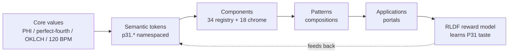

# Design System Semantic Contract

## What this is

The semantic contract defines how design intent flows through the P31 system.
It answers: where do raw values live, where does intent live, what may a
component consume, and what is stable across themes.

The flow is: **Core values → Semantic tokens → Components → Patterns →
Applications**. When this chain is clear, the system scales. When it is not,
every implementation becomes a local interpretation.

## The chain

## Contract rules (enforced, not advisory)

1. **Closed prop vocabulary** — a prop not declared in a component's contract
   does not exist. `additionalProperties:false` in `ui-schema.json`.
2. **Closed token namespace** — a token not in the `p31.*` namespace does not
   exist. A component may consume **only** the tokens its registry entry
   declares (its token contract). A violation is a falsification (non-
   compensatory, ADR 0004).
3. **Interactions are enumerated** — a state not on the global list
   (`default/hover/focus-visible/active/disabled/loading/error/success`)
   cannot be claimed by any contract.
4. **Every contract validates or it does not ship** — `validate-contracts.mjs`
   hard-fails on violation; `validate-registry.mjs` checks the derived
   registry.
5. **Status is pessimistic** — a contract defaults to `planned`; it must opt
   INTO claiming `shipped`. "Contracts cannot lie."

## Where it lives

| Artifact | Path | Role |
|---|---|---|
| Contract meta-schema (Zod) | `packages/canon/src/contracts/schema.ts` | The contract every component validates against |
| Design tokens | `software/design-tokens/p31-universal-canon.json` | PHI / perfect-fourth / OKLCH palette + semantic |
| Component registry | `packages/canon/registry.json` + `packages/design-core/registry.json` | 34 components + 18 chrome, typed props/tokens/a11y |
| Generated UI schema | `packages/ui-forge/ui-schema.json` | THAKI validity gate (ADR 0003) |
| Human-readable canon | `packages/canon/DESIGN.md` | AI agents read this before writing UI |

## The RLDF feedback loop

The semantic contract is not static. The RLDF reward model (ADR 0005) learns
from operator approvals and rejections:

- Approved designs → the reward model learns "this is P31 quantum material."
- Rejected designs → it learns "this is not."

Over time the reward model's score becomes the Governor's fidelity signal,
replacing the heuristic anti-slop rubric with learned P31 taste.

## Related

- [token-architecture.md](token-architecture.md) — the three-tier token model
- `packages/canon/docs/LUMI-TRAINING.md` — the fine-tune path