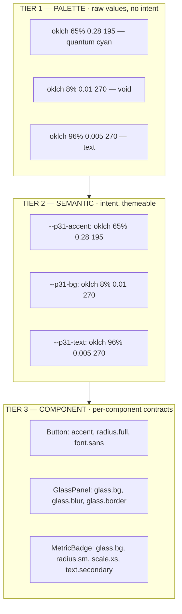

# Token Architecture — three tiers + DTCG governance

## The three tiers

Referencing direction is strict: **component → semantic → palette**. Skipping
tiers is a violation.

## Naming

`p31.<category>.<property>` — e.g. `p31.color.action.primary`,
`p31.radius.full`, `p31.motion.duration.fast`, `p31.space.md`.

- Registry items store the **bare** form (`surface.bg`); the schema and the
  Shaper namespace to `p31.surface.bg`.
- A token a component's contract does not allow is a falsification
  (non-compensatory, ADR 0004).

## Canonical source

`software/design-tokens/p31-universal-canon.json` is the single source of
truth: all visual values derive from **PHI (1.618)**, **Perfect Fourth
(1.333)**, a **4-multiple grid**, **OKLCH**, and **120 BPM** tempo. The
`@p31ca/design-core` v2 package consumes it; divergence is a type error.

## Governance

- **One canonical machine-readable source** — CSS custom properties, tokens,
  and the DTCG export are generated from it; do not hand-maintain derived
  forms.
- **External token files (Figma etc.)** MUST be validated against the W3C
  DTCG schema before ingestion.
- **`gen:tokens` regenerates** CSS + DTCG + registry; `validate-registry.mjs`
  checks the derived registry against contracts; `canon-purity` enforces the
  source-of-truth rule.
- **Who may change tokens** — @canon-owner. An unowned token is a dead token.
  Follow `runbooks/RUNBOOK-canonical-source.md` (repo root) before editing a
  design token.

## The registry (verified 2026-10-02)

- `packages/canon/registry.json` — tokens (205), components (Badge, Button),
  CSS classes (133), themes (11).
- `packages/design-core/registry.json` — 32 components + 18 chrome, each with
  typed props, tokens, variants, slots, a11y, importPath, cssClass.
- `packages/ui-forge/ui-schema.json` — the closed-vocabulary schema generated
  from both (34 unique component names), the THAKI validity contract.

## Related

- [contract.md](contract.md) — the semantic contract
- `runbooks/RUNBOOK-canonical-source.md` (repo root) — the edit procedure