# P31 Sovereign Shell — Master Connection Plan

**Generated by:** Connection Engineer Audit  
**Date:** 2026-08-17  
**Scope:** Full P31 ecosystem — 4 portals, 25+ workspace packages, 50+ Workers, 9 MCP servers, 7 audience portals, shared infrastructure, meatspace bonding, campaign dossier  

---

## 1. Executive Summary

### Total Connections Found

| Connection Type | Count | Status |
|----------------|-------|--------|
| Machine (fetch/HTTP) | 42 unique endpoints | 38 active, 4 unverified |
| Machine (WebSocket) | 3 distinct WS paths | 3 active |
| Machine (MCP servers) | 9 MCP endpoints | 9 active |
| Machine (Durable Objects) | 1 DO class | 1 active |
| Machine (Service Bindings) | 2 bidirectional | 2 active |
| Human (Identity) | 6 identity subsystems | 6 active |
| Human (Mesh) | 3 transport layers | 2 active, 1 deprecated |
| Human (Care) | 3 care systems | 3 active |
| Economic (LOVE) | 6 economic pathways | 6 active |
| Economic (Commerce) | 3 commerce systems | 3 active |
| Data (State Sync) | 4 sync tiers | 4 active |
| Data (Storage) | 3 storage layers | 3 active |
| Data (Outbox) | 3 drain triggers | 3 active |
| Protocol (MCP) | 9 MCP servers, ~200+ tools | 9 active |
| Protocol (KERI) | KEL + CESR + SAID | 1 active |
| Protocol (WebMCP) | Browser native tools | 1 active (trial) |
| Design (Tokens) | 124 CSS variables | 1 active |
| Design (Skins) | 5 brand variants | 5 active |
| Design (Assets) | 5 shared assets | 5 active |
| Deployment (Workers) | 21+ active Workers | 21+ active |
| Deployment (Pages) | 7 portal projects | 7 active |
| Deployment (Domains) | 3 custom domains | 3 active |
| **TOTAL** | **~120 unique connections** | |

### Critical Gaps Identified

1. **CSP Allowlist Mismatch**: Worker CSP includes `https://federation.p31ca.org` but `_headers` CSP does not — federation identity registration will fail silently in the `_headers`-served version.
2. **Spaceship Earth bidirectional binding**: Shell→Spaceship uses service binding, but Spaceship→Shell binding references `p31-shell` as a service — the reverse binding may not be configured on the deployed Worker.
3. **mesh-message outbox path**: `sendMeshMessage()` in outbox.ts is a TODO stub that drops messages.
4. **Ollama localhost**: CSP `connect-src` does not include `http://127.0.0.1:11434` — local LLM chat will fail.
5. **Phosphorus31 portal**: `wrangler.toml` exists but no `_worker.js` (backup file only) — portal is static-only, no dynamic endpoints.
6. **Kenosis mesh**: Dynamically imports `@p31ca/spaceship-earth/src/lib/engine/kenosisMesh` at runtime — this module may not exist in the bundle, falling back silently.

### Single Biggest Risk to System Coherence

**Cross-app state synchronization is the backbone of the ecosystem**, yet it depends on a single `CrossAppStateDO` Durable Object instance (name: `global`). If this DO enters an error state or is evicted, the Shell ↔ Spaceship Earth sync path breaks entirely, and there is no fallback beyond HTTP polling (Tier 4), which is read-only and throttled to 30s intervals. The WebSocket connection carries real-time spoon state, sensory preferences, and dataset payloads — a DO failure means all cross-device state sync stops.

---

## 2. Connection Matrix

### 2.1 Machine Connections

| Source | Connection Type | Target | Protocol | Endpoint | Status |
|--------|----------------|--------|----------|----------|--------|
| Shell (browser) | fetch | Shell Worker /mcp | HTTP POST | `https://p31-shell.trimtab-signal.workers.dev/mcp` | active |
| Shell (browser) | fetch | Shell Worker /api/health | HTTP GET | `https://p31-shell.trimtab-signal.workers.dev/api/health` | active |
| Shell (browser) | fetch | Shell Worker /api/status | HTTP GET | `https://p31-shell.trimtab-signal.workers.dev/api/status` | active |
| Shell (browser) | fetch | Shell Worker /api/duna/stats | HTTP GET | `https://p31-shell.trimtab-signal.workers.dev/api/duna/stats` | active |
| Shell (browser) | fetch | CrossApp /api/shell-state | HTTP GET | `https://p31-shell.trimtab-signal.workers.dev/api/shell-state` | active |
| Shell (browser) | fetch | CrossApp /api/shell-state | HTTP POST | `https://p31-shell.trimtab-signal.workers.dev/api/shell-state` | active |
| Shell (browser) | fetch | CrossApp /api/spaceship-state | HTTP GET | `https://p31-shell.trimtab-signal.workers.dev/api/spaceship-state` | active |
| Shell (browser) | fetch | CrossApp /api/spaceship-state | HTTP POST | `https://p31-shell.trimtab-signal.workers.dev/api/spaceship-state` | active |
| Shell (browser) | WebSocket | CrossApp /ws/state | WS | `wss://p31-shell.trimtab-signal.workers.dev/ws/state` | active |
| Shell (browser) | fetch | Spaceship Relay /health | HTTP GET | `https://spaceship-relay.trimtab-signal.workers.dev/health` | active |
| Shell (browser) | fetch | Spaceship Relay /api/spaceship-state | HTTP GET | `https://spaceship-relay.trimtab-signal.workers.dev/api/spaceship-state` | active |
| Shell (browser) | fetch | Design MCP | HTTP POST | `https://design-mcp.trimtab-signal.workers.dev` | active |
| Shell (browser) | fetch | Justice Hub /mcp | HTTP POST | `https://p31-justice-hub.trimtab-signal.workers.dev/mcp` | active |
| Shell (browser) | fetch | Marketplace MCP /mcp | HTTP POST | `https://marketplace-mcp.trimtab-signal.workers.dev/mcp` | active |
| Shell (browser) | fetch | Phenix Wallet /mcp | HTTP POST | `https://phenix-wallet-mcp.trimtab-signal.workers.dev/mcp` | active |
| Shell (browser) | fetch | PQC Crypto /mcp | HTTP POST | `https://p31-crypto-mcp.trimtab-signal.workers.dev/mcp` | active |
| Shell (browser) | fetch | BROS Care /mcp | HTTP POST | `https://bros.trimtab-signal.workers.dev/mcp` | active |
| Shell (browser) | fetch | DADS Trust /mcp | HTTP POST | `https://dads.trimtab-signal.workers.dev/mcp` | active |
| Shell (browser) | fetch | Roblox Bridge /mcp | HTTP POST | `https://roblox-bridge.trimtab-signal.workers.dev/mcp` | active |
| Shell (browser) | fetch | Roblox Bridge /health | HTTP GET | `https://roblox-bridge.trimtab-signal.workers.dev/health` | active |
| Shell (browser) | fetch | Roblox Bridge /deploy | HTTP POST | `https://roblox-bridge.trimtab-signal.workers.dev/deploy` | active |
| Shell (browser) | fetch | Shadow Bridge /game/pending-love | HTTP POST | `https://shadow-bridge.trimtab-signal.workers.dev/game/pending-love` | active |
| Shell (browser) | fetch | Game Builder /route | HTTP POST | `https://game-builder.trimtab-signal.workers.dev/route` | active |
| Shell (browser) | fetch | Vibe Generate /generate | HTTP POST | `https://vibe-generate.trimtab-signal.workers.dev/generate` | active |
| Shell (browser) | fetch | Vibe Generate /deploy | HTTP POST | `https://vibe-generate.trimtab-signal.workers.dev/deploy` | active |
| Shell (browser) | fetch | Vibe Sandbox /execute | HTTP POST | `https://vibe-sandbox.trimtab-signal.workers.dev/execute` | active |
| Shell (browser) | fetch | Portal Chat /chat | HTTP POST | `https://portal-chat.trimtab-signal.workers.dev/chat` | active |
| Shell (browser) | fetch | Portal Chat /chat/result | HTTP POST | `https://portal-chat.trimtab-signal.workers.dev/chat/result` | active |
| Shell (browser) | fetch | LOVE Ledger /api/love/earn | HTTP POST | `https://love-ledger.p31ca.org/api/love/earn` | active |
| Shell (browser) | fetch | LOVE Ledger /api/love/chain | HTTP GET | `https://love-ledger.p31ca.org/api/love/chain` | active |
| Shell (browser) | fetch | LOVE Ledger /api/love/balance/:did | HTTP GET | `https://love-ledger.p31ca.org/api/love/balance/{did}` | active |
| Shell (browser) | fetch | Intent Resolver /intent | HTTP POST | `https://intent-resolver.trimtab-signal.workers.dev/intent` | active |
| Shell (browser) | fetch | Creation Accountant /receipt | HTTP POST | `https://creation-accountant.trimtab-signal.workers.dev/receipt` | active |
| Shell (browser) | fetch | Federation /identity/register | HTTP POST | `https://federation.p31ca.org/identity/register` | active |
| Shell (browser) | fetch | Ledger Bridge /kem/xwing/encapsulate | HTTP POST | `https://ledger-bridge.trimtab-signal.workers.dev/kem/xwing/encapsulate` | active |
| Shell (browser) | fetch | Ledger Bridge /credential/issue | HTTP POST | `https://ledger-bridge.trimtab-signal.workers.dev/credential/issue` | active |
| Shell (browser) | fetch | Ledger Bridge /credential/verify | HTTP POST | `https://ledger-bridge.trimtab-signal.workers.dev/credential/verify` | active |
| Shell (browser) | fetch | Ledger Bridge /care-proof | HTTP POST | `https://ledger-bridge.trimtab-signal.workers.dev/care-proof` | active |
| Shell (browser) | fetch | Node Zero /api/hardware/challenge | HTTP POST | `https://p31ca.org/api/hardware/challenge` | active |
| Shell (browser) | fetch | Node Zero /api/hardware/pair | HTTP POST | `https://p31ca.org/api/hardware/pair` | active |
| Shell (browser) | fetch | Node Zero /api/hardware/telemetry | HTTP POST | `https://p31ca.org/api/hardware/telemetry` | active |
| Shell (browser) | fetch | Status Aggregator /health | HTTP GET | `https://status.p31ca.org/health` | active |
| Shell (browser) | fetch | Zenodo API | HTTP GET | `https://zenodo.org/api/records?...` | active |
| Shell (browser) | fetch | Tailscale API | HTTP GET | `https://api.tailscale.com/api/v2/tailnet/...` | unverified |
| Shell (browser) | fetch | Ollama Local | HTTP GET | `http://127.0.0.1:11434/api/tags` | unverified |
| Shell Worker | fetch (service binding) | Spaceship Relay /health | HTTP GET | Service binding `SPACESHIP_RELAY` → `spaceship-relay` | active |
| Spaceship Worker | fetch (service binding) | Shell Worker | HTTP GET | Service binding `P31_SHELL` → `p31-shell` | unverified |
| Shell Worker | Durable Object | CrossAppStateDO | WebSocket/HTTP | `CROSS_APP_STATE` binding | active |
| BROS (browser) | WebSocket | SignalingRoom | WS | `wss://bros.trimtab-signal.workers.dev/rooms/{roomId}` | active |

### 2.2 Human Connections

| Source | Connection Type | Target | Protocol | Endpoint | Status |
|--------|----------------|--------|----------|----------|--------|
| Shell (browser) | Key Generation | Ed25519 | Web Crypto API | In-memory KeyStore | active |
| Shell (browser) | Key Generation | ML-DSA-65 | @noble/post-quantum | In-memory PQC KeyStore | active |
| Shell (browser) | DID Creation | did:key | base58(SPKI) | localStorage | active |
| Shell (browser) | Federation Registration | federation.p31ca.org | HTTP POST | `/identity/register` | active |
| Shell (browser) | PQC Registration | federation.p31ca.org | HTTP POST | `/identity/register` (mldsa65_pub) | active |
| Shell (browser) | KERI KEL | IndexedDB | Local | `identity-keys` store | active |
| Shell (browser) | KERI Broadcast | Mesh peers | libp2p signaling | `broadcastSync('kel', ...)` | active |
| Shell (browser) | KERI Verify | Mesh peers | libp2p signaling | `verifyKEL()` | active |
| Shell (browser) | Mesh Connect | libp2p | WebRTC-Direct | BROS signaling room | active |
| Shell (browser) | Mesh Signaling | BROS SignalingRoom | WebSocket | `wss://bros.../rooms/p31-libp2p-mesh` | active |
| Shell (browser) | Mesh Heartbeat | All peers | libp2p signaling | `broadcastSync('heartbeat', ...)` | active |
| Shell (browser) | Tailscale Discovery | Tailscale API | HTTPS | `api.tailscale.com` | unverified |
| Shell (browser) | BROS Persona | BROS Worker | MCP | `bros.trimtab-signal.workers.dev/mcp` | active |
| Shell (browser) | DADS Trust | DADS Worker | MCP | `dads.trimtab-signal.workers.dev/mcp` | active |
| Shell (browser) | Node Zero Pair | p31ca.org | HTTP | `/api/hardware/*` | active |
| Shell (browser) | Kenosis Mesh | spaceship-earth | Dynamic import | `@p31ca/spaceship-earth/kenosisMesh` | unverified |

### 2.3 Economic Connections

| Source | Connection Type | Target | Protocol | Endpoint | Status |
|--------|----------------|--------|----------|----------|--------|
| Shell (browser) | LOVE Earn | love-ledger | HTTP POST | `/api/love/earn` | active |
| Shell (browser) | LOVE Balance | love-ledger | HTTP GET | `/api/love/balance/{did}` | active |
| Shell (browser) | LOVE Chain | love-ledger | HTTP GET | `/api/love/chain` | active |
| Shell (browser) | LOVE Engine | @p31ca/love-ledger | Local | LedgerEngine (localStorage) | active |
| Shell (browser) | Game Builder | game-builder | HTTP POST | `/route` (worlds, mint, love) | active |
| Shell (browser) | Shadow Bridge | shadow-bridge | HTTP POST | `/game/pending-love` | active |
| Shell (browser) | Intent Quote | intent-resolver | HTTP POST | `/intent` | active |
| Shell (browser) | Creation Receipt | creation-accountant | HTTP POST | `/receipt` | active |
| Shell (browser) | Marketplace | marketplace-mcp | MCP | `marketplace-mcp.../mcp` | active |
| Shell (browser) | Justice/Escrow | justice-hub | MCP | `p31-justice-hub.../mcp` | active |
| Shell (browser) | SBT Mint | ledger-bridge | HTTP | `/care-proof`, `/credential/*` | active |
| Shell (browser) | KEM X-Wing | ledger-bridge | HTTP POST | `/kem/xwing/encapsulate` | active |
| Shell (browser) | SD-JWT Issue | ledger-bridge | HTTP POST | `/credential/issue` | active |
| Shell (browser) | SD-JWT Verify | ledger-bridge | HTTP POST | `/credential/verify` | active |
| Shell (browser) | Outbox Ledger | PGLite | IndexedDB | `outbox` table (ledger-append) | active |

### 2.4 Data Connections

| Source | Connection Type | Target | Protocol | Status |
|--------|----------------|--------|----------|--------|
| Shell (browser) | Tier 1 | BroadcastChannel | `p31-cross-app-state` | active |
| Shell (browser) | Tier 2 | localStorage | `p31-cross-app-state` | active |
| Shell (browser) | Tier 3 | WebSocket → CrossAppStateDO | WS `wss://.../ws/state` | active |
| Shell (browser) | Tier 4 | HTTP Polling | `GET /api/shell-state` (30s) | active |
| Shell (browser) | IndexedDB | p31-shell-db (v3) | 7 object stores | active |
| Shell (browser) | PGLite | idb://p31-shell | 5 tables + outbox index | active |
| Shell (browser) | Zustand | useAppStore | @p31ca/sovereign-core | active |
| Shell (browser) | Zustand | useShellStore | zustand/persist | active |
| Shell (browser) | Zustand | useSensoryStore | zustand | active |
| Shell (browser) | Zustand | useEffectsStore | zustand | active |
| Shell (browser) | Zustand | useHistoryStore | zustand | active |
| Shell (browser) | Zustand | useSandboxStore | zustand | active |
| Shell (browser) | Outbox | PGLite → mesh/ledger | Background Sync + visibilitychange | active |
| Shell (browser) | SW Cache | Workbox | Service Worker | active |
| CrossAppStateDO | SQLite | CF Storage | `app_state` table | active |

### 2.5 Protocol Connections

| Source | Connection Type | Target | Protocol | Status |
|--------|----------------|--------|----------|--------|
| Shell Worker | MCP Server | /mcp endpoint | JSON-RPC 2.0 (2026-07-28) | active |
| Shell (browser) | MCP Client | 8 remote servers | JSON-RPC 2.0 | active |
| Shell (browser) | WebMCP | Chrome 149+ | navigator.modelContext | active (trial) |
| Shell (browser) | KERI | Local + Mesh | CESR + SAID | active |
| Shell (browser) | SD-JWT | ledger-bridge | RFC 9901 | active |
| Shell (browser) | X-Wing KEM | ledger-bridge | draft-ietf-lamp-xwing | active |
| Shell (browser) | Care Proof | ledger-bridge | Ed25519 + ML-DSA-65 dual-sig | active |
| Shell (browser) | x402 | mcp-x402-gateway | HTTP 402 + PAYMENT-REQUIRED | active (edge) |
| Shell (browser) | Taler | taler-bridge-billing | GNU Taler CBS + WASM | active (edge) |
| Shell (browser) | DID Resolution | federation.p31ca.org | did:key / did:jwk / did:web | active |

### 2.6 Design Connections

| Source | Connection Type | Target | Protocol | Status |
|--------|----------------|--------|----------|--------|
| design-core | Token Generation | tokens.yml → CSS | Build-time | active |
| design-core | Component CSS | components.css | Static | active |
| Shell | CSS Import | components.css | `<link>` / Vite import | active |
| Skin System | Runtime Override | CSS variables | `--p31-*` | active |
| 7 Portals | Asset Injection | p31-ui.umd.js | Deploy-time copy | active |
| 7 Portals | WebMCP Registry | webmcp-registry.js | Deploy-time copy | active |
| 7 Portals | State Sync | state-sync.js | Deploy-time copy | active |
| 7 Portals | Shared SW | sw.js | Deploy-time copy | active |
| 7 Portals | Shared _worker.js | CSP nonce injection | Wrangler asset | active |

### 2.7 Deployment Connections

| Source | Connection Type | Target | Domain | Status |
|--------|----------------|--------|--------|--------|
| Shell Worker | Cloudflare Worker | p31-shell | `p31-shell.trimtab-signal.workers.dev` | active |
| Spaceship | Cloudflare Pages | spaceship-relay | `spaceship-earth.pages.dev` | active |
| Portal: Children | CF Pages | p31-portal-children | `willow.p31ca.org` | active |
| Portal: Parent | CF Pages | p31-portal-parent | `tetra.p31ca.org` | active |
| Portal: Teen | CF Pages | p31-portal-teen | `sixseven.p31ca.org` | active |
| Portal: Meatspace | CF Pages | p31-portal-meatspace | `meatspace.p31ca.org` | active |
| Portal: Developer | CF Pages | p31-portal-developer | `p31ca.org` | active |
| Portal: Institutional | CF Pages | p31-portal-institutional | `phosphorus31.org` | active |
| Portal: Design | CF Pages | p31-portal-design | `design.p31ca.org` | active |
| Federation Bridge | CF Worker | federation-bridge | `federation.p31ca.org` | active |
| LOVE Ledger | CF Worker | love-ledger | `love-ledger.p31ca.org` | active |
| Game Builder | CF Worker | game-builder | `game-builder.trimtab-signal.workers.dev` | active |
| Vibe Generate | CF Worker | vibe-generate | `vibe-generate.trimtab-signal.workers.dev` | active |
| Vibe Sandbox | CF Worker | vibe-sandbox | `vibe-sandbox.trimtab-signal.workers.dev` | active |
| Portal Chat | CF Worker | portal-chat | `portal-chat.trimtab-signal.workers.dev` | active |
| Roblox Bridge | CF Worker | roblox-bridge | `roblox-bridge.trimtab-signal.workers.dev` | active |
| Shadow Bridge | CF Worker | shadow-bridge | `shadow-bridge.trimtab-signal.workers.dev` | active |
| Design MCP | CF Worker | design-mcp | `design-mcp.trimtab-signal.workers.dev` | active |
| Justice Hub | CF Worker | p31-justice-hub | `p31-justice-hub.trimtab-signal.workers.dev` | active |
| Marketplace MCP | CF Worker | marketplace-mcp | `marketplace-mcp.trimtab-signal.workers.dev` | active |
| Phenix Wallet | CF Worker | phenix-wallet-mcp | `phenix-wallet-mcp.trimtab-signal.workers.dev` | active |
| PQC Crypto | CF Worker | p31-crypto-mcp | `p31-crypto-mcp.trimtab-signal.workers.dev` | active |
| BROS | CF Worker | bros | `bros.trimtab-signal.workers.dev` | active |
| DADS | CF Worker | dads | `dads.trimtab-signal.workers.dev` | active |
| Intent Resolver | CF Worker | intent-resolver | `intent-resolver.trimtab-signal.workers.dev` | active |
| Creation Accountant | CF Worker | creation-accountant | `creation-accountant.trimtab-signal.workers.dev` | active |
| Ledger Bridge | CF Worker | ledger-bridge | `ledger-bridge.trimtab-signal.workers.dev` | active |
| Agent Runtime | CF Worker | agent-runtime | `agent-runtime.trimtab-signal.workers.dev` | active |
| Care Mesh | CF Worker | care-mesh | `care-mesh.trimtab-signal.workers.dev` | active |
| Status Aggregator | CF Worker | status | `status.p31ca.org` | active |
| MCP-x402 Gateway | CF Worker | mcp-x402-gateway | `mcp-x402-gateway.trimtab-signal.workers.dev` | active |

---

## 3. Dependency Graph

```mermaid
graph TB
    subgraph "Shell Ecosystem"
        SH[Shell Browser App]
        SW[Shell Worker - p31-shell]
        DO[CrossAppStateDO]
        PC[PGLite - idb://p31-shell]
        IDB[IndexedDB - p31-shell-db]
        LS[localStorage]
    end

    subgraph "Machine Layer"
        SR[Spaceship Relay Worker]
        GM[Game Builder Worker]
        VG[Vibe Generate Worker]
        VS[Vibe Sandbox Worker]
        PC2[Portal Chat Worker]
        RB[Roblox Bridge Worker]
        SB[Shadow Bridge Worker]
        IR[Intent Resolver Worker]
        CA[Creation Accountant Worker]
        LB[Ledger Bridge Worker]
        FB[Federation Bridge Worker]
        LL[LOVE Ledger Worker]
    end

    subgraph "MCP Layer"
        MCP_S[Shell MCP - 90 tools]
        MCP_D[Design MCP - 13 tools]
        MCP_J[Justice Hub - 8 tools]
        MCP_M[Marketplace MCP - 10 tools]
        MCP_W[Phenix Vault - 5 tools]
        MCP_C[PQC Crypto - 12 tools]
        MCP_BR[BROS Care - 8 tools]
        MCP_DA[DADS Trust - 7 tools]
        MCP_RB[Roblox Bridge MCP - 14 tools]
    end

    subgraph "Identity Layer"
        DID[Ed25519 Keys]
        PQC[ML-DSA-65 Keys]
        KEL[KERI Key Event Log]
        CP[Cognitive Passport]
    end

    subgraph "Mesh Layer"
        LP2P[libp2p WebRTC-Direct]
        BROS_S[BROS SignalingRoom]
        TS[Tailscale Discovery]
        KN[Kenosis Mesh]
    end

    subgraph "Design System"
        DC[design-core]
        SK[skin-system]
        CC[components.css]
        UI[p31-ui.umd.js]
    end

    subgraph "Portals"
        P1[willow.p31ca.org]
        P2[tetra.p31ca.org]
        P3[sixseven.p31ca.org]
        P4[meatspace.p31ca.org]
        P5[p31ca.org]
        P6[phosphorus31.org]
        P7[design.p31ca.org]
    end

    subgraph "External"
        ZD[Zenodo API]
        TAL[Tailscale API]
        OLL[Ollama Local]
        ZE[zenodo.org]
    end

    %% Shell → Workers
    SW -->|service binding| SR
    SW -->|CROSS_APP_STATE DO| DO
    SR -->|service binding| SH

    %% Browser → MCP
    SH -->|fetch| MCP_S
    SH -->|fetch| MCP_D
    SH -->|fetch| MCP_J
    SH -->|fetch| MCP_M
    SH -->|fetch| MCP_W
    SH -->|fetch| MCP_C
    SH -->|fetch| MCP_BR
    SH -->|fetch| MCP_DA
    SH -->|fetch| MCP_RB

    %% Browser → Workers
    SH -->|fetch| GM
    SH -->|fetch| VG
    SH -->|fetch| VS
    SH -->|fetch| PC2
    SH -->|fetch| RB
    SH -->|fetch| SB
    SH -->|fetch| IR
    SH -->|fetch| CA
    SH -->|fetch| LB
    SH -->|fetch| FB
    SH -->|fetch| LL

    %% Identity
    SH --> DID
    SH --> PQC
    DID --> KEL
    PQC --> KEL
    KEL --> CP

    %% Mesh
    SH --> LP2P
    LP2P --> BROS_S
    SH --> TS
    SH --> KN

    %% Data
    SH --> PC
    SH --> IDB
    SH --> LS
    DO --> PC

    %% Design
    DC --> SK
    DC --> CC
    SK --> UI
    CC --> SH
    UI --> P1
    UI --> P2
    UI --> P3
    UI --> P4
    UI --> P5
    UI --> P6
    UI --> P7

    %% External
    SH --> ZD
    SH --> TAL
    SH --> OLL

    %% Identity → Federation
    DID --> FB
    PQC --> FB

    %% LOVE flow
    SH -->|earn| LL
    SH -->|balance| LL
    SH -->|chain| LL
    GM --> SB
    SB --> SH
```



---

## 3.5 MCP Tool-Count Reconciliation (verified 2026-09-03)

| Server | Claimed (docs) | Source of truth | Live (`tools/list`) | Verdict |
|--------|---------------|-----------------|---------------------|---------|
| **Design MCP** | 23 | `portals/design/design-core/src/mcp/tool-registry.ts` = **13** | **13** | ✅ code == live; docs inflated → corrected to 13 above |
| **Shell MCP** | 90 | `shell/src/lib/commands.ts` `getOpenAIFunctionDefinitions()` ≈ **102** | **0 at edge** | ⚠️ browser-bound command module does not load on the Cloudflare Worker, so standalone edge `tools/list` returns an empty array. Works in-browser only. |

**Action:** before any A2UI / MCP registry submission, reconcile claimed counts to the verified values and (for Shell MCP) either deploy a Workers-compatible command module or document it as browser-bound only.

---

## 4. Gap Analysis

### 4.1 Machine Connections

#### What exists but is undocumented
- **`/api/duna/stats`** endpoint in worker.ts (line 100) — serves `{ members: 1, active: 0, target: 100 }` but is not listed in the service registry or documented anywhere.
- **`/api/status`** endpoint — aggregates shell + spaceship health but is only referenced in commands.ts as a user command, not in any operational docs.
- **SW CSP exception** (worker.ts:167-171) — deliberately strips CSP for `/sw.js` and `/workbox-*` paths; this is documented in AGENTS.md but not in any connection diagram.
- **Health check endpoints on Workers** — `game-builder`, `vibe-generate`, `vibe-sandbox`, `portal-chat`, `roblox-bridge` all have `/health` endpoints probed by `useWorkerHealth.ts` but the aggregate URL `https://status.p31ca.org/health` is a separate system.
- **MCP health endpoint** (`/mcp/health`) — exists in worker.ts but is not called by any shell code (the `ping()` function in mcpClient.ts calls the main `/mcp` endpoint instead).

#### What is documented but doesn't exist
- **`https://p31-design-mcp.trimtab-signal.workers.dev/`** — referenced in mcpClient.ts as `LEGACY_URL` and in CSP allowlist, but the MCP registry uses `https://design-mcp.trimtab-signal.workers.dev` (no `p31-` prefix). The old URL may redirect or 404.
- **`https://love-ledger.p31ca.org`** — listed in service registry as a URL but this domain likely doesn't exist as a Cloudflare Pages project; the actual worker is `love-ledger.trimtab-signal.workers.dev` (or uses a custom domain via Worker route).
- **`https://app.p31ca.org`** — listed in ALLOWED_ORIGINS but no deployment exists for this subdomain.
- **`https://www.p31ca.org`** — listed in ALLOWED_ORIGINS but no www subdomain deployment is configured.

#### What is planned but not started
- **OAuth bootstrap** — mentioned in prompt as "planned for v1.2.2" but no OAuth code exists anywhere in the shell source.
- **Stripe integration** — mentioned in prompt but no Stripe API calls exist in the shell codebase.
- **mesh-message outbox path** — `sendMeshMessage()` in outbox.ts (line 169-172) is a TODO that drops messages with a console.warn.
- **PeerJS transport** — `mesh.ts` references PeerJS as a fallback but the code was removed (line 66-68 says "PeerJS-based HeartbeatMesh is deprecated and removed"). The `mesh:transport` command still lists `peerjs` as an option.

#### What is broken or degraded
- **CSP mismatch between worker.ts and _headers** — `worker.ts` CSP includes `https://federation.p31ca.org` in connect-src but `public/_headers` CSP does not. If the Worker is bypassed (e.g., direct Pages access), federation calls will be blocked.
- **Ollama localhost connection** — CSP `connect-src` does not include `http://127.0.0.1:11434`, so `ollama:status` and `ollama:chat` commands will fail even if Ollama is running.
- **`mesh-message` outbox** — drops messages silently; any point-to-point messaging via the outbox is non-functional.
- **Kenosis mesh** — dynamically imports `@p31ca/spaceship-earth/src/lib/engine/kenosisMesh` using `Function('return import(...)')()` — this is a code injection pattern that will fail in strict CSP environments and may not resolve in bundled builds.

### 4.2 Human Connections

#### What exists but is undocumented
- **KERI CESR encoding** — `keri.ts` implements a simplified CESR encoding (colon-separated) and SAID computation (SHA-256 base64url truncated to 44 chars). This is a custom implementation, not a standard CESR codec.
- **PQC legacy key migration** — both identity.ts and pqc.ts have migration paths from base64-encoded legacy keys to in-memory-only storage. The migration logic is critical but undocumented.
- **Dual-signature heartbeats** — mesh heartbeats carry both Ed25519 and ML-DSA-65 signatures plus KEL events. This is the strongest authentication in the system but is only documented in code comments.

#### What is documented but doesn't exist
- **libp2p browser support** — `libp2pMesh.ts` imports `@libp2p/webrtc` and `@chainsafe/libp2p-noise`, but browser WebRTC-Direct via libp2p is experimental. The connection may fail silently and fall back to "peerjs" mode (which is itself deprecated).
- **BROS room creation** — the comment in libp2pMesh.ts (line 7-8) states "BROS has no POST /room/create — rooms are lazily created by the DO via idFromName(roomId)" — but the BROS MCP tools include `bros_room_create`. This may be a newer addition not reflected in the mesh code.

#### What is planned but not started
- **OAuth bootstrap** — no OAuth flow exists.
- **Federation profile discovery** — federation-bridge has `GET /identity/discover` endpoint but the shell has no code that calls it.
- **DIDComm v2** — federation-bridge implements `POST /didcomm/send` and `GET /didcomm/inbox/:did` but the shell has no DIDComm client code.

#### What is broken or degraded
- **PeerJS fallback** — mesh.ts still lists `peerjs` as a transport option in the `mesh:transport` command, but PeerJS code has been removed. Selecting PeerJS will silently fail.
- **Tailscale discovery** — `listTailscaleDevices()` returns online devices but `connectSignaling()` in libp2pMesh.ts doesn't use Tailscale IPs for direct connection; it only uses them as "hostname hints" (line 80-84 comment).

### 4.3 Economic Connections

#### What exists but is undocumented
- **LOVE Engine event system** — `loveEngine.ts` uses an EventEmitter pattern (`on('LOVE_EARNED', ...)`) from `@p31ca/love-ledger`. Events drive snapshot invalidation and localStorage persistence, but this event flow is not documented.
- **Dual-economy store** — `@p31ca/shared/economy` exports `useDualEconomyStore`, `initLoveSync`, `connectLedgerAppender`, `hydrateFromLedger` — these bridge the local LedgerEngine with the PGLite ledger table via the outbox.
- **Bonding state** — `bondingState.ts` maintains a separate `p31:shell:bonding` localStorage key that tracks `loveDelta` and completed rituals, distinct from the LOVE Engine.

#### What is documented but doesn't exist
- **Phenix Vault MCP interaction** — the shell registers `mcp:wallet` pointing to `phenix-wallet-mcp.trimtab-signal.workers.dev/mcp` with 5 tools, but there is no shell-side code that calls these tools (no `callMCPTool('wallet', ...)` in commands.ts).
- **Justice Hub MCP interaction** — similarly, `mcp:justice` is registered but no shell command calls justice tools directly. The justice panel UI exists but the MCP call path is unclear.
- **Marketplace MCP interaction** — `mcp:marketplace` is registered but no shell command calls marketplace tools.

#### What is planned but not started
- **Peer-to-peer LOVE settlement** — `lovePayments.ts` (line 5-6) states "True peer-to-peer settlement (mesh/shadow-bridge) lands in a later phase."
- **x402 pay-per-call from shell** — x402 is deployed on the gateway but the shell has no x402 payment flow (no `X-Creation-Unit` header logic).
- **Taler integration from shell** — Taler blind signatures are deployed on the edge but the shell has no Taler client code.
- **Stripe donate** — mentioned in prompt but no Stripe code exists.

#### What is broken or degraded
- **Roblox LOVE sync** — `robloxBridge.ts` calls `shadow-bridge.trimtab-signal.workers.dev/game/pending-love` which returns pending LOVE events. If the shadow-bridge is down, `syncRobloxLove()` returns an error object but the UI may not surface it.

### 4.4 Data Connections

#### What exists but is undocumented
- **PGLite schema** — db.ts creates 5 tables (ledger, rules, zones, zone_access_log, outbox) + 1 index. The `rules` and `zones` tables are created but never populated by any shell code.
- **IndexedDB stores** — memory.ts defines 7 stores (threads, notifications, memory, spoons-history, identity-keys, pqc-keys, goals) but `threads` and `goals` are only used by specific features (assistant threads, cognitive task breakdown).
- **BroadcastChannel** — `useCrossAppState.ts` creates a `p31-cross-app-state` channel for same-browser tab sync, but this is only useful if multiple shell tabs are open simultaneously.

#### What is documented but doesn't exist
- **SW caching of shell assets** — the shell uses Workbox (`/sw.js`, `/workbox-*`) for caching, but the specific cache strategy is not documented. The CSP exception for Workbox scripts is documented in AGENTS.md.
- **Outbox Background Sync** — `useOutboxDrain.ts` registers `outbox-drain` with the Service Worker's Background Sync API, but the shell's SW (Workbox) may not handle this event unless explicitly configured.

#### What is planned but not started
- **Outbox mesh-message** — TODO stub, drops messages.
- **Rules engine** — `rules` table in PGLite exists but no code populates or queries it.
- **Zones engine** — `zones` and `zone_access_log` tables exist but no code populates or queries them.

### 4.5 Protocol Connections

#### What exists but is undocumented
- **MCP protocol version** — the shell MCP server declares `protocolVersion: '2026-07-28'` (mcpServer.ts:74) which is a future date — this is a custom version string, not a standard MCP protocol version.
- **WebMCP tool registration** — `useRegisterShellMCP.ts` registers tools with `document.modelContext.registerTool()` AND `window.__p31MCPTools`, providing dual registration for browser agents and programmatic access.
- **A2UI host** — `a2uiHost.ts` renders declarative component JSON into the DOM — this is a parallel rendering system for AI-generated UI.

#### What is documented but doesn't exist
- **CARS wire protocol** — mentioned in the prompt as a protocol connection but no CARS implementation exists in the shell codebase. CARS is mentioned in `packages/shared/src/cars-wire.ts` but this is in the workspace packages, not the shell.

#### What is planned but not started
- **x402 client in shell** — no payment protocol client exists.
- **UCAN tokens** — mentioned in prompt but no UCAN implementation in shell (exists in `packages/sovereign/src/ucan.ts` but not wired into shell).

### 4.6 Design Connections

#### What exists but is undocumented
- **Design token flow** — `tokens.yml` → `design-core` → generated CSS → `components.css` → shell `index.css`. The generation pipeline is in `design-core/scripts/` but the specific build steps are not documented in the shell.
- **Skin system** — `skin-system/src/registry.ts` provides runtime CSS variable overrides. Five skin packages exist (apex, phos, tetra, willow, skin-system base) but the shell's theme store (`useThemeStore`) only exposes 5 themes (garden, ocean, aurora, zen, volt) — the mapping between skin packages and theme IDs is undocumented.
- **A2UI catalog** — `/.well-known/a2ui-catalog.json` provides 15 component schemas for AI agents but is served by the edge render worker, not the shell.

### 4.7 Deployment Connections

#### What exists but is undocumented
- **Shared _worker.js CSP injection** — `shared/_worker.js` injects nonce-based CSP into HTML responses for all portals. The nonce is generated per-request via `crypto.randomUUID()`. This is the security backbone for all portal deployments.
- **Portal deploy pipeline** — `deploy-portals.js` stages each portal, injects shared assets (p31-ui.umd.js, state-sync.js, webmcp-registry.js, components.css), copies shared SW, and deploys via `wrangler pages deploy`. The pipeline handles both static and React portals.

#### What is documented but doesn't exist
- **app.p31ca.org** — listed in ALLOWED_ORIGINS but no deployment exists.
- **www.p31ca.org** — listed in ALLOWED_ORIGINS but no deployment exists.

#### What is planned but not started
- **design.p31ca.org** — listed in deploy-portals.js but the design portal source directory (`portals/design/deploy/`) was not found in the file listing.

---

## 5. Recommendations

### Priority 1: Critical (Impact: System Coherence | Risk: High | Effort: Low)

1. **Fix CSP mismatch between worker.ts and _headers**
   - Add `https://federation.p31ca.org` to the `_headers` CSP `connect-src`.
   - Add `https://federation.p31ca.org` to `shared/_worker.js` CSP `connect-src`.
   - **Files:** `public/_headers`, `shared/_worker.js`

2. **Add Ollama localhost to CSP**
   - Add `http://127.0.0.1:11434` to `connect-src` in both worker.ts and _headers CSP.
   - **Files:** `src/worker.ts:39`, `public/_headers:7`

3. **Remove dead PeerJS transport option**
   - Remove `peerjs` from the `mesh:transport` command options in commands.ts.
   - Update mesh.ts documentation to reflect libp2p-only transport.
   - **Files:** `src/lib/commands.ts:808`

4. **Implement mesh-message outbox path**
   - `sendMeshMessage()` in outbox.ts is a TODO. Either implement point-to-point mesh messaging or remove the outbox entry kind.
   - **Files:** `src/lib/outbox.ts:169-172`

### Priority 2: High (Impact: System Coherence | Risk: Medium | Effort: Medium)

5. **Wire MCP tool calls for Justice, Marketplace, and Phenix Vault**
   - These 3 MCP servers are registered in the registry but no shell commands call their tools. Add explicit tool-call commands or integrate them into the MCP Explorer.
   - **Files:** `src/data/serviceRegistry.ts`, `src/lib/mcpRegistry.ts`

6. **Verify Spaceship Earth → Shell reverse service binding**
   - The shell binds `SPACESHIP_RELAY` → `spaceship-relay`, and spaceship-earth.toml binds `P31_SHELL` → `p31-shell`. Verify the reverse binding works in production.
   - **Files:** `production/packages/spaceship-earth/wrangler.toml`

7. **Fix Kenosis mesh dynamic import pattern**
   - `kenosis.ts` uses `Function('return import(...)')()` which bypasses CSP `script-src`. Either bundle the import or use a standard dynamic import with error handling.
   - **Files:** `src/lib/kenosis.ts:10`

8. **Document LOVE Engine event flow**
   - The LOVE Engine's event-driven architecture (LOVE_EARNED → snapshot invalidation → localStorage persist → React re-render) is a critical data flow path that should be documented.
   - **Files:** `src/lib/loveEngine.ts`

### Priority 3: Medium (Impact: Feature Completeness | Risk: Low | Effort: Medium)

9. **Implement x402 payment flow in shell**
   - The x402 gateway is deployed but the shell has no payment client. Add x402 payment headers to MCP tool calls for paid tools.
   - **Files:** New file needed

10. **Implement OAuth bootstrap**
    - Planned for v1.2.2 but no code exists. This is needed for third-party integrations.
    - **Files:** New file needed

11. **Wire DIDComm v2 client**
    - Federation bridge has DIDComm endpoints but no shell client exists.
    - **Files:** New file needed

12. **Document skin-system ↔ theme-store mapping**
    - The 5 skin packages (apex, phos, tetra, willow, base) map to 5 shell themes (garden, ocean, aurora, zen, volt) but the mapping is undocumented.
    - **Files:** `src/store/useThemeStore.ts`, `packages/skin-system/src/`

### Priority 4: Low (Impact: Cleanup | Risk: Low | Effort: Low)

13. **Clean up dead ALLOWED_ORIGINS entries**
    - Remove `https://app.p31ca.org` and `https://www.p31ca.org` from ALLOWED_ORIGINS if no deployment exists.
    - **Files:** `src/worker.ts:7-8`

14. **Remove or populate PGLite rules/zones tables**
    - The `rules` and `zones` tables are created but never used. Either implement the rules engine or remove the tables.
    - **Files:** `src/lib/db.ts`

15. **Fix legacy MCP URL**
    - `mcpClient.ts` uses `LEGACY_URL = 'https://p31-design-mcp.trimtab-signal.workers.dev/'` (with `p31-` prefix) while the registry uses `design-mcp.trimtab-signal.workers.dev` (without prefix). Verify which is correct.
    - **Files:** `src/lib/mcpClient.ts:3`

16. **Document MCP health endpoint usage**
    - `/mcp/health` exists in worker.ts but is never called. Either use it in health checks or remove it.
    - **Files:** `src/worker.ts:107-112`, `src/hooks/useWorkerHealth.ts`

---

## 6. Connection Registry (CSV-Ready)

```csv
source,type,target,protocol,endpoint,status,owner,last-verified
shell-browser,fetch,shell-worker,/mcp,https://p31-shell.trimtab-signal.workers.dev/mcp,active,shell,2026-08-17
shell-browser,fetch,shell-worker,/api/health,https://p31-shell.trimtab-signal.workers.dev/api/health,active,shell,2026-08-17
shell-browser,fetch,shell-worker,/api/status,https://p31-shell.trimtab-signal.workers.dev/api/status,active,shell,2026-08-17
shell-browser,fetch,shell-worker,/api/duna/stats,https://p31-shell.trimtab-signal.workers.dev/api/duna/stats,active,shell,2026-08-17
shell-browser,fetch,cross-app-state,/api/shell-state GET,https://p31-shell.trimtab-signal.workers.dev/api/shell-state,active,shell,2026-08-17
shell-browser,fetch,cross-app-state,/api/shell-state POST,https://p31-shell.trimtab-signal.workers.dev/api/shell-state,active,shell,2026-08-17
shell-browser,fetch,cross-app-state,/api/spaceship-state GET,https://p31-shell.trimtab-signal.workers.dev/api/spaceship-state,active,shell,2026-08-17
shell-browser,fetch,cross-app-state,/api/spaceship-state POST,https://p31-shell.trimtab-signal.workers.dev/api/spaceship-state,active,shell,2026-08-17
shell-browser,websocket,cross-app-state,/ws/state,wss://p31-shell.trimtab-signal.workers.dev/ws/state,active,shell,2026-08-17
shell-browser,fetch,spaceship-relay,/health,https://spaceship-relay.trimtab-signal.workers.dev/health,active,spaceship,2026-08-17
shell-browser,fetch,spaceship-relay,/api/spaceship-state,https://spaceship-relay.trimtab-signal.workers.dev/api/spaceship-state,active,spaceship,2026-08-17
shell-browser,fetch,design-mcp,/,https://design-mcp.trimtab-signal.workers.dev,active,design-mcp,2026-08-17
shell-browser,fetch,justice-hub,/mcp,https://p31-justice-hub.trimtab-signal.workers.dev/mcp,active,justice,2026-08-17
shell-browser,fetch,marketplace-mcp,/mcp,https://marketplace-mcp.trimtab-signal.workers.dev/mcp,active,marketplace,2026-08-17
shell-browser,fetch,phenix-wallet-mcp,/mcp,https://phenix-wallet-mcp.trimtab-signal.workers.dev/mcp,active,wallet,2026-08-17
shell-browser,fetch,p31-crypto-mcp,/mcp,https://p31-crypto-mcp.trimtab-signal.workers.dev/mcp,active,crypto,2026-08-17
shell-browser,fetch,bros,/mcp,https://bros.trimtab-signal.workers.dev/mcp,active,bros,2026-08-17
shell-browser,fetch,dads,/mcp,https://dads.trimtab-signal.workers.dev/mcp,active,dads,2026-08-17
shell-browser,fetch,roblox-bridge,/mcp,https://roblox-bridge.trimtab-signal.workers.dev/mcp,active,roblox,2026-08-17
shell-browser,fetch,roblox-bridge,/health,https://roblox-bridge.trimtab-signal.workers.dev/health,active,roblox,2026-08-17
shell-browser,fetch,roblox-bridge,/deploy,https://roblox-bridge.trimtab-signal.workers.dev/deploy,active,roblox,2026-08-17
shell-browser,fetch,shadow-bridge,/game/pending-love,https://shadow-bridge.trimtab-signal.workers.dev/game/pending-love,active,shadow-bridge,2026-08-17
shell-browser,fetch,game-builder,/route,https://game-builder.trimtab-signal.workers.dev/route,active,game-builder,2026-08-17
shell-browser,fetch,vibe-generate,/generate,https://vibe-generate.trimtab-signal.workers.dev/generate,active,sandbox,2026-08-17
shell-browser,fetch,vibe-generate,/deploy,https://vibe-generate.trimtab-signal.workers.dev/deploy,active,sandbox,2026-08-17
shell-browser,fetch,vibe-sandbox,/execute,https://vibe-sandbox.trimtab-signal.workers.dev/execute,active,sandbox,2026-08-17
shell-browser,fetch,portal-chat,/chat,https://portal-chat.trimtab-signal.workers.dev/chat,active,chat,2026-08-17
shell-browser,fetch,portal-chat,/chat/result,https://portal-chat.trimtab-signal.workers.dev/chat/result,active,chat,2026-08-17
shell-browser,fetch,love-ledger,/api/love/earn,https://love-ledger.p31ca.org/api/love/earn,active,love-ledger,2026-08-17
shell-browser,fetch,love-ledger,/api/love/chain,https://love-ledger.p31ca.org/api/love/chain,active,love-ledger,2026-08-17
shell-browser,fetch,love-ledger,/api/love/balance/:did,https://love-ledger.p31ca.org/api/love/balance/{did},active,love-ledger,2026-08-17
shell-browser,fetch,intent-resolver,/intent,https://intent-resolver.trimtab-signal.workers.dev/intent,active,intent-resolver,2026-08-17
shell-browser,fetch,creation-accountant,/receipt,https://creation-accountant.trimtab-signal.workers.dev/receipt,active,creation-accountant,2026-08-17
shell-browser,fetch,federation-bridge,/identity/register,https://federation.p31ca.org/identity/register,active,federation,2026-08-17
shell-browser,fetch,ledger-bridge,/kem/xwing/encapsulate,https://ledger-bridge.trimtab-signal.workers.dev/kem/xwing/encapsulate,active,ledger-bridge,2026-08-17
shell-browser,fetch,ledger-bridge,/credential/issue,https://ledger-bridge.trimtab-signal.workers.dev/credential/issue,active,ledger-bridge,2026-08-17
shell-browser,fetch,ledger-bridge,/credential/verify,https://ledger-bridge.trimtab-signal.workers.dev/credential/verify,active,ledger-bridge,2026-08-17
shell-browser,fetch,ledger-bridge,/care-proof,https://ledger-bridge.trimtab-signal.workers.dev/care-proof,active,ledger-bridge,2026-08-17
shell-browser,fetch,node-zero,/api/hardware/challenge,https://p31ca.org/api/hardware/challenge,active,hardware,2026-08-17
shell-browser,fetch,node-zero,/api/hardware/pair,https://p31ca.org/api/hardware/pair,active,hardware,2026-08-17
shell-browser,fetch,node-zero,/api/hardware/telemetry,https://p31ca.org/api/hardware/telemetry,active,hardware,2026-08-17
shell-browser,fetch,status-aggregator,/health,https://status.p31ca.org/health,active,status,2026-08-17
shell-browser,fetch,zenodo,/api/records,https://zenodo.org/api/records,active,research,2026-08-17
shell-browser,fetch,tailscale,api/tailnet/devices,https://api.tailscale.com/api/v2/tailnet/*/devices,unverified,tailscale,2026-08-17
shell-browser,fetch,ollama,localhost:11434,http://127.0.0.1:11434/api/tags,unverified,local-ai,2026-08-17
shell-browser,websocket,bros-signaling,/rooms/p31-libp2p-mesh,wss://bros.trimtab-signal.workers.dev/rooms/p31-libp2p-mesh,active,bros,2026-08-17
shell-worker,service-binding,spaceship-relay,SPACESHIP_RELAY,service:spaceship-relay,active,infra,2026-08-17
spaceship-worker,service-binding,shell,P31_SHELL,service:p31-shell,unverified,infra,2026-08-17
shell-worker,durable-object,cross-app-state,CROSS_APP_STATE,CrossAppStateDO,active,infra,2026-08-17
shell-browser,identity,ed25519,webcrypto,in-memory-key-store,active,identity,2026-08-17
shell-browser,identity,ml-dsa-65,@noble/post-quantum,in-memory-pqc-store,active,identity,2026-08-17
shell-browser,identity,keri-kel,indexeddb,identity-keys store,active,identity,2026-08-17
shell-browser,identity,cognitive-passport,local,localStorage,active,identity,2026-08-17
shell-browser,data,pqlite,idb://p31-shell,PGLite 5 tables,active,data,2026-08-17
shell-browser,data,indexeddb,p31-shell-db,7 object stores,active,data,2026-08-17
shell-browser,data,localstorage,p31-cross-app-state,JSON state blob,active,data,2026-08-17
shell-browser,data,outbox,pqlite-outbox,3 drain triggers,active,data,2026-08-17
shell-browser,design,tokens,design-core,tokens.yml→CSS,active,design,2026-08-17
shell-browser,design,skins,skin-system,5 brand variants,active,design,2026-08-17
shell-browser,design,assets,components.css,static CSS,active,design,2026-08-17
shell-browser,webmcp,browser-agent,navigator.modelContext,Chrome 149+ trial,active,webmcp,2026-08-17
shell-browser,protocol,mcp,json-rpc-2.0,9 servers ~200+ tools,active,protocol,2026-08-17
shell-browser,protocol,keri,cesr+said,KEL hash chain,active,protocol,2026-08-17
shell-browser,protocol,sdjwt,rfc-9901,ledger-bridge,active,protocol,2026-08-17
shell-browser,protocol,kem-xwing,draft-ietf-lamp-xwing,ledger-bridge,active,protocol,2026-08-17
deploy,cf-worker,p31-shell,worker,p31-shell.trimtab-signal.workers.dev,active,deploy,2026-08-17
deploy,cf-pages,spaceship-relay,pages,spaceship-earth.pages.dev,active,deploy,2026-08-17
deploy,cf-pages,portal-children,pages,willow.p31ca.org,active,deploy,2026-08-17
deploy,cf-pages,portal-parent,pages,tetra.p31ca.org,active,deploy,2026-08-17
deploy,cf-pages,portal-teen,pages,sixseven.p31ca.org,active,deploy,2026-08-17
deploy,cf-pages,portal-meatspace,pages,meatspace.p31ca.org,active,deploy,2026-08-17
deploy,cf-pages,portal-developer,pages,p31ca.org,active,deploy,2026-08-17
deploy,cf-pages,portal-institutional,pages,phosphorus31.org,active,deploy,2026-08-17
deploy,cf-pages,portal-design,pages,design.p31ca.org,active,deploy,2026-08-17
deploy,cf-worker,federation-bridge,worker,federation.p31ca.org,active,deploy,2026-08-17
deploy,cf-worker,love-ledger,worker,love-ledger.p31ca.org,active,deploy,2026-08-17
deploy,cf-worker,game-builder,worker,game-builder.trimtab-signal.workers.dev,active,deploy,2026-08-17
deploy,cf-worker,vibe-generate,worker,vibe-generate.trimtab-signal.workers.dev,active,deploy,2026-08-17
deploy,cf-worker,vibe-sandbox,worker,vibe-sandbox.trimtab-signal.workers.dev,active,deploy,2026-08-17
deploy,cf-worker,portal-chat,worker,portal-chat.trimtab-signal.workers.dev,active,deploy,2026-08-17
deploy,cf-worker,roblox-bridge,worker,roblox-bridge.trimtab-signal.workers.dev,active,deploy,2026-08-17
deploy,cf-worker,shadow-bridge,worker,shadow-bridge.trimtab-signal.workers.dev,active,deploy,2026-08-17
deploy,cf-worker,design-mcp,worker,design-mcp.trimtab-signal.workers.dev,active,deploy,2026-08-17
deploy,cf-worker,justice-hub,worker,p31-justice-hub.trimtab-signal.workers.dev,active,deploy,2026-08-17
deploy,cf-worker,marketplace-mcp,worker,marketplace-mcp.trimtab-signal.workers.dev,active,deploy,2026-08-17
deploy,cf-worker,phenix-wallet-mcp,worker,phenix-wallet-mcp.trimtab-signal.workers.dev,active,deploy,2026-08-17
deploy,cf-worker,p31-crypto-mcp,worker,p31-crypto-mcp.trimtab-signal.workers.dev,active,deploy,2026-08-17
deploy,cf-worker,bros,worker,bros.trimtab-signal.workers.dev,active,deploy,2026-08-17
deploy,cf-worker,dads,worker,dads.trimtab-signal.workers.dev,active,deploy,2026-08-17
deploy,cf-worker,intent-resolver,worker,intent-resolver.trimtab-signal.workers.dev,active,deploy,2026-08-17
deploy,cf-worker,creation-accountant,worker,creation-accountant.trimtab-signal.workers.dev,active,deploy,2026-08-17
deploy,cf-worker,ledger-bridge,worker,ledger-bridge.trimtab-signal.workers.dev,active,deploy,2026-08-17
deploy,cf-worker,agent-runtime,worker,agent-runtime.trimtab-signal.workers.dev,active,deploy,2026-08-17
deploy,cf-worker,care-mesh,worker,care-mesh.trimtab-signal.workers.dev,active,deploy,2026-08-17
deploy,cf-worker,status-aggregator,worker,status.p31ca.org,active,deploy,2026-08-17
deploy,cf-worker,mcp-x402-gateway,worker,mcp-x402-gateway.trimtab-signal.workers.dev,active,deploy,2026-08-17
```

---

## Appendix A: All fetch() URLs in Shell Source

Traced via grep across `src/`:

| File | URL | Method | Purpose |
|------|-----|--------|---------|
| `src/lib/identity.ts:176` | `https://federation.p31ca.org/identity/register` | POST | DID registration |
| `src/lib/pqc.ts:135` | `https://federation.p31ca.org/identity/register` | POST | PQC registration |
| `src/lib/pqc.ts:155` | `https://ledger-bridge.trimtab-signal.workers.dev/kem/xwing/encapsulate` | POST | X-Wing KEM |
| `src/lib/pqc.ts:170` | `https://ledger-bridge.trimtab-signal.workers.dev/credential/issue` | POST | SD-JWT issue |
| `src/lib/pqc.ts:184` | `https://ledger-bridge.trimtab-signal.workers.dev/credential/verify` | POST | SD-JWT verify |
| `src/lib/pqc.ts:204` | `https://ledger-bridge.trimtab-signal.workers.dev/care-proof` | POST | Care proof |
| `src/lib/commands.ts:379` | `https://love-ledger.p31ca.org/api/love/earn` | POST | LOVE earn |
| `src/lib/commands.ts:395` | `https://love-ledger.p31ca.org/api/love/chain` | GET | LOVE chain |
| `src/lib/commands.ts:409` | `https://intent-resolver.trimtab-signal.workers.dev/intent` | POST | Intent quote |
| `src/lib/commands.ts:431` | `https://creation-accountant.trimtab-signal.workers.dev/receipt` | POST | Creation receipt |
| `src/lib/commands.ts:577` | `https://roblox-bridge.trimtab-signal.workers.dev/health` | GET | Roblox health |
| `src/lib/commands.ts:590` | `https://roblox-bridge.trimtab-signal.workers.dev/deploy` | POST | Roblox deploy |
| `src/lib/commands.ts:656` | `https://love-ledger.p31ca.org/api/love/balance/{did}` | GET | LOVE balance |
| `src/lib/commands.ts:669` | `https://love-ledger.p31ca.org/api/love/balance/{did}` | GET | LOVE balance |
| `src/lib/commands.ts:915` | `https://love-ledger.p31ca.org/api/love/chain` | GET | LOVE chain (export) |
| `src/lib/commands.ts:916` | `https://love-ledger.p31ca.org/api/love/balance/{did}` | GET | LOVE balance (export) |
| `src/lib/commands.ts:981` | `https://spaceship-relay.trimtab-signal.workers.dev/api/spaceship-state` | GET | Spaceship state |
| `src/lib/commands.ts:982` | `https://spaceship-relay.trimtab-signal.workers.dev/api/spaceship-state` | POST | Load constellation |
| `src/lib/robloxBridge.ts:18` | `https://shadow-bridge.trimtab-signal.workers.dev/game/pending-love` | POST | Roblox LOVE sync |
| `src/lib/gameBuilder.ts:1` | `https://game-builder.trimtab-signal.workers.dev/route` | POST | Game builder API |
| `src/lib/tailscale.ts:40` | `https://api.tailscale.com/api/v2/tailnet/{tailnet}/devices` | GET | Tailscale devices |
| `src/lib/ollama.ts:9` | `http://127.0.0.1:11434/api/tags` | GET | Ollama models |
| `src/lib/ollama.ts:17` | `http://127.0.0.1:11434/api/tags` | GET | Ollama models |
| `src/lib/nodeZero.ts:29` | `https://p31ca.org/api/hardware/challenge` | POST | Node Zero challenge |
| `src/lib/nodeZero.ts:42` | `https://p31ca.org/api/hardware/pair` | POST | Node Zero pair |
| `src/lib/nodeZero.ts:57` | `https://p31ca.org/api/hardware/telemetry` | POST | Node Zero telemetry |
| `src/lib/zenodo.ts:4` | `https://zenodo.org/api/records?...` | GET | Zenodo papers |
| `src/lib/llm.ts:7` | `https://portal-chat.trimtab-signal.workers.dev/chat` | POST | Chat |
| `src/lib/llm.ts:8` | `https://portal-chat.trimtab-signal.workers.dev/chat/result` | POST | Chat result |
| `src/lib/mcpClient.ts:3` | `https://p31-design-mcp.trimtab-signal.workers.dev/` | POST | Legacy MCP URL |
| `src/lib/mcpRegistry.ts:68` | `https://design-mcp.trimtab-signal.workers.dev` | POST | Design MCP |
| `src/lib/mcpRegistry.ts:94` | (all MCP_ENDPOINTS URLs) | POST | MCP tool calls |
| `src/lib/mcpServer.ts` | (handles inbound /mcp) | POST | MCP server |
| `src/hooks/useCrossAppState.ts:100` | `https://p31-shell.trimtab-signal.workers.dev/api/shell-state` | GET | HTTP poll |
| `src/hooks/useCrossAppState.ts:228` | `https://p31-shell.trimtab-signal.workers.dev/api/state` | DELETE | Clear state |
| `src/hooks/useWorkerHealth.ts:12` | `https://status.p31ca.org/health` | GET | Health aggregate |
| `src/hooks/useWorkerHealth.ts:34-41` | (7 fallback worker /health URLs) | GET | Fallback health |
| `src/features/sandbox/remote.ts:1` | `https://vibe-generate.trimtab-signal.workers.dev/generate` | POST | Generate |
| `src/features/sandbox/remote.ts:2` | `https://vibe-generate.trimtab-signal.workers.dev/deploy` | POST | Deploy |
| `src/features/sandbox/remote.ts:3` | `https://vibe-sandbox.trimtab-signal.workers.dev/execute` | POST | Execute |
| `src/features/bonding/questEngine.ts:37` | `https://love-ledger.p31ca.org/api/love/earn` | POST | Quest LOVE mint |
| `src/lib/mesh/libp2pMesh.ts:14` | `https://bros.trimtab-signal.workers.dev` | WS | BROS signaling |
| `src/worker.ts:180` | `https://spaceship-relay.trimtab-signal.workers.dev/health` | GET | Spaceship health (service binding) |

## Appendix B: Allowed Origins Matrix

| Origin | worker.ts ALLOWED_ORIGINS | mcpServer.ts ALLOWED_ORIGINS | Notes |
|--------|--------------------------|------------------------------|-------|
| `https://p31ca.org` | ✅ | ✅ | Developer portal |
| `https://www.p31ca.org` | ✅ | ✅ | No deployment exists |
| `https://app.p31ca.org` | ✅ | ❌ | No deployment exists |
| `https://p31-shell.trimtab-signal.workers.dev` | ✅ | ❌ | Shell worker itself |
| `https://spaceship-earth.pages.dev` | ✅ | ❌ | Spaceship Earth |
| `http://localhost:5200` | ✅ | ✅ (DEV only) | Dev server |
| `http://localhost:5173` | ✅ | ❌ | Vite default |
| `http://localhost:4173` | ✅ | ❌ | Vite preview |
| `http://localhost:3000` | ✅ | ✅ (DEV only) | Dev server |

**Mismatch:** `p31-shell.trimtab-signal.workers.dev` and `spaceship-earth.pages.dev` are in worker.ts but not in mcpServer.ts — cross-origin MCP calls from Spaceship Earth to Shell MCP will be blocked.

## Appendix C: CSP connect-src Comparison

| Endpoint | worker.ts CSP | _headers CSP | shared/_worker.js CSP |
|----------|--------------|-------------|----------------------|
| `self` | ✅ | ✅ | N/A (nonce-based) |
| `https://api.p31ca.org` | ✅ | ✅ | ❌ |
| `https://mcp-x402-gateway.p31ca.org` | ✅ | ✅ | ❌ |
| `https://p31-design-mcp.trimtab-signal.workers.dev` | ✅ | ✅ | ❌ |
| `https://federation.p31ca.org` | ✅ | ❌ | ❌ |
| `https://zenodo.org` | ✅ | ✅ | ❌ |
| `https://render.p31ca.org` | ❌ | ❌ | ✅ |
| `https://gateway.p31ca.org` | ❌ | ❌ | ✅ |
| `https://static.cloudflareinsights.com` | ❌ | ❌ | ✅ |
| `http://127.0.0.1:11434` | ❌ | ❌ | ❌ |

**Critical:** `https://federation.p31ca.org` is in worker.ts CSP but missing from `_headers` CSP — federation calls will be blocked when served via Pages (not Worker).
